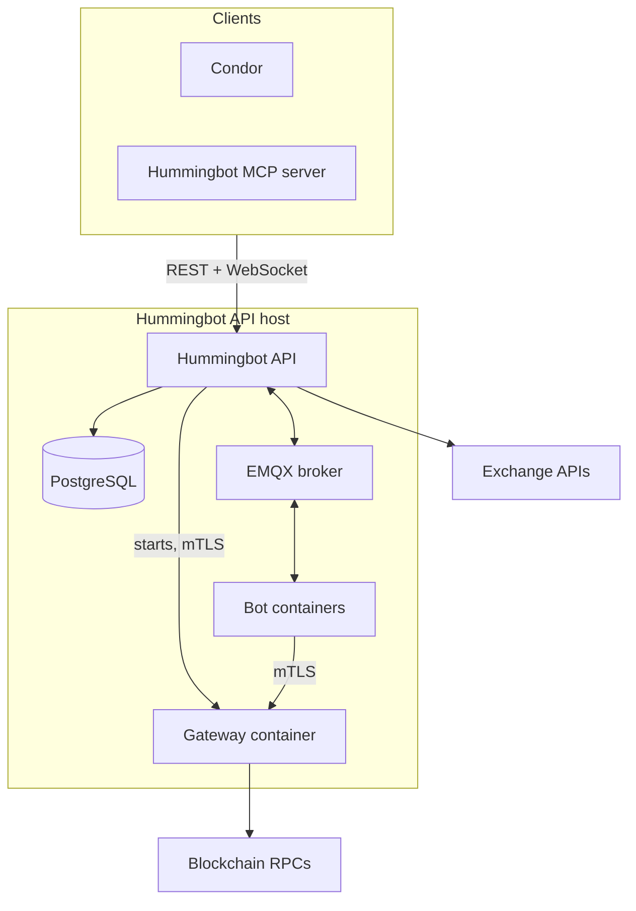
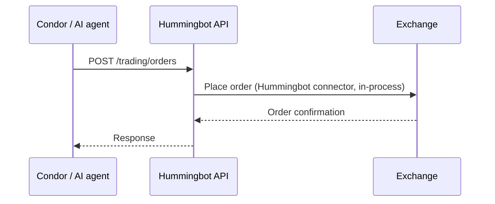

Hummingbot API is a FastAPI server that gives programmatic access to the Hummingbot trading framework. It is the execution layer under Condor: Condor's dashboard, Telegram bot and trading agents all act through it.

## System Architecture



Condor never talks to Gateway directly. Every DEX action goes through the Hummingbot API.

## Components

### Clients

| Component | Description |
|-----------|-------------|
| **Condor** | Web dashboard, Telegram bot and LLM trading agents. Agents call the API through Condor's own MCP tools. |
| **Hummingbot MCP server** | A separate [MCP server](https://hummingbot.org/mcp/) that lets AI assistants such as Claude, Gemini and ChatGPT call the API. |

### Server

| Component | Description |
|-----------|-------------|
| **Hummingbot API** | The REST and WebSocket server. It loads the Hummingbot library in-process for exchange connectors, market data and [executors](/executors/overview). |
| **PostgreSQL** | Stores account and token balances, orders, trades, positions, funding payments, bot runs, executors, performance snapshots and Gateway swap and LP history. |
| **EMQX** | MQTT broker. Bot containers report status and performance to the API through it. |
| **Bot containers** | One Docker container per deployed bot, running the `hummingbot/hummingbot` image. The API creates and starts them. |
| **Gateway** | DEX middleware, run as a Docker container that the API starts and manages. See [Gateway](#gateway) below. |

## How It Works

1. **Clients** (Condor, the MCP server, your own scripts) send requests to the Hummingbot API.
2. **CEX trading and market data** run inside the API, through the Hummingbot library's exchange connectors.
3. **Executors** also run inside the API, with no bot container needed.
4. **Bots** run in their own containers and report back over EMQX.
5. **DEX trading** goes from the API to Gateway, which signs transactions and sends them to blockchain RPCs.

## Gateway

Gateway is not part of the API's Docker Compose stack. The API starts it on request:

- **Dashboard:** **Settings → Gateway → Deploy Gateway**. See [Settings](/webui/settings#gateway).
- **Telegram:** `/gateway` → **🚀 Deploy Gateway**.
- **API:** `POST /gateway/start`.

The default image is `hummingbot/gateway:development` on port `15888`. Gateway always runs with TLS and mutual TLS (mTLS): the API, and every bot it deploys, presents a client certificate. The API generates the certificates and uses your `CONFIG_PASSWORD` as Gateway's passphrase, so there is nothing extra to enter.

When the API runs in Docker (`make deploy`), Gateway's port is published on `127.0.0.1` only, and the API reaches it by container name at `https://gateway:15888`. When the API runs from source on Linux, Gateway uses host networking.

## Deployment

### Docker (recommended)

```bash
git clone https://github.com/hummingbot/hummingbot-api
cd hummingbot-api
make setup    # asks for your API username, password and config password; writes .env
make deploy   # starts the API, PostgreSQL and EMQX in Docker
```

`make setup` also asks whether to use Tailscale for remote access. The API listens on `127.0.0.1:8000`. To change that, see [Base URL](/api-reference#base-url).

### From source

Running from source needs Conda.

```bash
make install  # creates the hummingbot-api Conda environment, then runs make setup
make run      # starts PostgreSQL and EMQX in Docker, then the API with auto-reload
```

Run `make doctor` to check dependencies, `.env`, containers, port exposure and API access. Run `make stop` to stop the Docker services.

For installing Condor and the API together, see [Install Condor](/getting-started/installing).

## Data Flow



## Learn More

<CardGroup cols={2}>
  <Card title="Hummingbot" icon="robot" href="/api-reference/hummingbot">
    The core trading framework
  </Card>
  <Card title="Gateway" icon="shuffle" href="/api-reference/gateway">
    DEX middleware for decentralized trading
  </Card>
</CardGroup>
