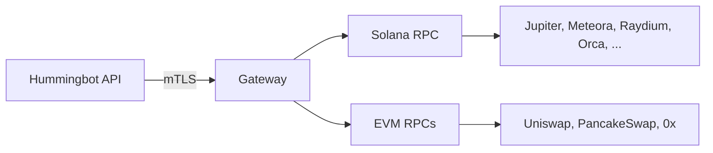

**Gateway** is DEX middleware that lets Hummingbot API trade on decentralized exchanges. It gives one interface for swapping tokens and providing liquidity across Solana and EVM chains.

## What is Gateway?

Gateway is a separate service that:

- Connects to blockchain RPCs
- Stores wallet keys and signs transactions
- Provides one API across different DEX protocols
- Submits transactions and tracks their status

The Hummingbot API starts Gateway as a Docker container and talks to it over mutual TLS. Condor never talks to Gateway directly: every DEX action goes through the API. See [Architecture](/api-reference/architecture#gateway).



## Supported Connectors

These are the connectors in the `hummingbot/gateway:development` image. Your server's own list is at `GET /gateway/connectors`.

| Connector | Chain | Router (swaps) | AMM | CLMM | Networks |
|-----------|-------|:---:|:---:|:---:|----------|
| `jupiter` | Solana | ✅ | | | mainnet-beta, devnet |
| `titan` | Solana | ✅ | | | mainnet-beta |
| `dflow` | Solana | ✅ | | | mainnet-beta |
| `okx` (OKX DEX) | Solana | ✅ | | | mainnet-beta |
| `meteora` | Solana | | ✅ | ✅ | mainnet-beta, devnet |
| `raydium` | Solana | | ✅ | ✅ | mainnet-beta, devnet |
| `orca` | Solana | | | ✅ | mainnet-beta, devnet |
| `pancakeswap-sol` | Solana | | | ✅ | mainnet-beta, devnet |
| `uniswap` | EVM | ✅ | ✅ | ✅ | mainnet, arbitrum, avalanche, base, bsc, celo, optimism, polygon, robinhoodchain, unichain |
| `pancakeswap` | EVM | ✅ | ✅ | ✅ | mainnet, arbitrum, base, bsc |
| `0x` | EVM | ✅ | | | mainnet, arbitrum, avalanche, base, bsc, optimism, polygon |

- **Router** connectors find a swap route across many pools.
- **AMM** pools spread liquidity over the full price range.
- **CLMM** (concentrated liquidity) pools let you choose a price range.

## Supported Chains

Gateway groups networks under two chains. A network ID is `chain-network`, for example `solana-mainnet-beta` or `ethereum-bsc`.

| Chain | Networks |
|-------|----------|
| `ethereum` (EVM) | `mainnet`, `arbitrum`, `avalanche`, `base`, `bsc`, `celo`, `optimism`, `polygon`, `robinhoodchain`, `unichain`, and the testnets `sepolia` and `robinhoodchain-testnet` |
| `solana` | `mainnet-beta`, and the testnet `devnet` |

`GET /gateway/networks` lists every network ID on your server.

## Setup

### 1. Start Gateway

Gateway doesn't start with the API. Start it once from any of these:

- **Workspace:** **Settings → Gateway → Deploy Gateway**. See [Settings](/webui/settings#gateway).
- **Telegram:** `/gateway` → **🚀 Deploy Gateway**.
- **API:** `POST /gateway/start`. The body can be empty (`{}`). It defaults to the image `hummingbot/gateway:development` on port `15888`.

Gateway always runs with TLS and mutual TLS. The API creates the certificates and uses your API's `CONFIG_PASSWORD` as Gateway's passphrase, so you don't enter one. When the API runs in Docker, Gateway's port is published on `127.0.0.1` only.

### 2. Add a wallet

Gateway signs transactions with a wallet stored on your server. Use a wallet that holds only what you're prepared to trade with.

- **Workspace:** **Settings → Keys and Wallets → Add Wallet**. See [Add a Gateway wallet](/getting-started/credentials#add-a-gateway-wallet).
- **Telegram:** `/gateway` → **🔑 Wallets** → **➕ Add Wallet**, pick the chain, then send the private key.
- **API:**

```bash
curl -u YOUR_USERNAME:YOUR_PASSWORD -X POST http://localhost:8000/accounts/gateway/add-wallet \
  -H "Content-Type: application/json" \
  -d '{
    "chain": "solana",
    "private_key": "YOUR_PRIVATE_KEY"
  }'
```

`set_default` is optional and defaults to `true`: the new wallet becomes the default for its chain.

### 3. Configure networks

Each network has its own settings, such as its RPC endpoint (`node_url`) and default swap provider:

```bash
# List network IDs
curl -u YOUR_USERNAME:YOUR_PASSWORD http://localhost:8000/gateway/networks

# Read one network's settings
curl -u YOUR_USERNAME:YOUR_PASSWORD http://localhost:8000/gateway/networks/solana-mainnet-beta
```

A `POST` to the same path updates them. Tokens and pools have their own subpaths: `/gateway/networks/{network_id}/tokens` and `/gateway/networks/{network_id}/pools`. In the Workspace, the same settings are under **Settings → Gateway → Networks & RPC**.

### 4. Check it's running

```bash
curl -u YOUR_USERNAME:YOUR_PASSWORD http://localhost:8000/gateway/status
```

```json
{
  "running": true,
  "container_id": "3ce264fe002e...",
  "image": "hummingbot/gateway:development",
  "created_at": "2026-10-14T13:34:37.799199064Z",
  "port": 15888
}
```

## Using Gateway through the API

### Swaps

Get a quote with `POST /gateway/swap/quote`:

```bash
curl -u YOUR_USERNAME:YOUR_PASSWORD -X POST http://localhost:8000/gateway/swap/quote \
  -H "Content-Type: application/json" \
  -d '{
    "connector": "jupiter",
    "network": "solana-mainnet-beta",
    "trading_pair": "SOL-USDC",
    "side": "SELL",
    "amount": 1.0
  }'
```

- `amount` is always in the base token. For `SELL` it is the amount to sell; for `BUY` it is the amount to receive.
- `connector` is a router name (`jupiter`), or a typed name such as `raydium/amm` or `meteora/clmm` to swap through one pool type.

`POST /gateway/swap/execute` takes the same fields and sends the swap. It also takes optional `slippage_pct` and `wallet_address`. Without `wallet_address`, it uses the chain's default wallet. Past swaps are searchable with `POST /gateway/swaps/search`, and a transaction's status is at `GET /gateway/swaps/{transaction_hash}/status`.

### Liquidity positions

The `/gateway/clmm` endpoints take the **bare connector name**, such as `raydium`, `meteora` or `orca`. For example, `pool-info` answers `400` to `connector=raydium/clmm`.

```bash
# List pools. Pool listing supports meteora and orca only.
curl -u YOUR_USERNAME:YOUR_PASSWORD \
  "http://localhost:8000/gateway/clmm/pools?connector=meteora&search_term=SOL&limit=5"

# Get one pool's live state (any CLMM connector)
curl -u YOUR_USERNAME:YOUR_PASSWORD \
  "http://localhost:8000/gateway/clmm/pool-info?connector=raydium&network=solana-mainnet-beta&pool_address=POOL_ADDRESS"
```

To open a position, use `POST /gateway/clmm/open`. `/gateway/clmm/add`, `/remove`, `/collect-fees` and `/close` act on an existing position by its `position_address`. Full-range AMM liquidity has its own router under `/gateway/amm`.

To run a position that is monitored and closed for you, use an [LP executor](/executors/lp-executor). For a complete example, see [Guide: Solana DEX LP Expert Agent](/examples/solana-lp).

## Gateway vs CEX Connectors

| Aspect | CEX connectors | Gateway |
|--------|----------------|---------|
| **Custody** | The exchange holds your funds | You hold the keys, on your server |
| **Fees** | Trading fees | Network fees plus pool or protocol fees |
| **Where it runs** | Inside the Hummingbot API | A separate container the API starts |

## Resources

<CardGroup cols={2}>
  <Card title="Gateway GitHub" icon="github" href="https://github.com/hummingbot/gateway">
    Gateway source code
  </Card>
  <Card title="Gateway Docs" icon="book" href="https://hummingbot.org/gateway/">
    Full Gateway documentation
  </Card>
</CardGroup>
