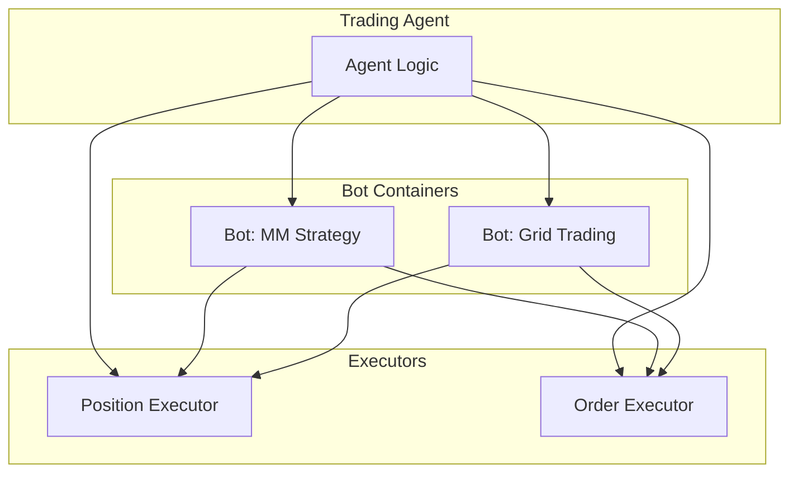

**Bots** are Docker containers running Hummingbot instances for long-running automation tasks. They execute [Scripts](/bots/scripts) for simpler tasks or [Controllers](/bots/controllers) for algorithmic trading strategies.

## Bots vs Executors

| Aspect | Executors | Bots |
|--------|-----------|------|
| **Lifecycle** | Short-lived (minutes to hours) | Long-running (days to weeks) |
| **Scope** | Single operation | Complex strategies |
| **Control** | Agent-controlled | Autonomous or supervised |
| **Use Case** | Individual trades | Continuous market making |



## When to Use Bots

| Scenario | Use | Reason |
|----------|-----|--------|
| Single directional trade | Executor | Short-lived, defined outcome |
| Continuous market making | Bot | Long-running, complex logic |
| One-time swap | Executor | Simple, immediate |
| Multi-leg arbitrage | Bot | Requires coordination |
| LP position with time limit | Executor | Self-contained lifecycle |
| 24/7 grid trading | Bot | Persistent, adaptive |

## Bot Lifecycle

### Creation

A bot runs one or more saved controller configs. Create the configs first (see [Controllers](/bots/controllers)), then deploy a bot that runs them.

**Workspace**: on the [Bots](/webui/bots#deploy-bot) page, click **Deploy bot**, select one or more configs, and click **Deploy**.

**Telegram**: send `/new_bot`, select one or more configs, choose **🚀 Deploy**, and answer the prompts for instance name, credentials profile, drawdown limits and image. Telegram lists configs for `grid_strike`, `pmm_mister` and `pmm_v1` only.

**API**: deploy a bot from existing controller config files (without `.yml`). Pass several configs to run multiple controllers in one bot:
```bash
curl -u YOUR_USERNAME:YOUR_PASSWORD -X POST http://localhost:8000/bot-orchestration/deploy-v2-controllers \
  -H "Content-Type: application/json" \
  -d '{
    "instance_name": "my-market-maker",
    "credentials_profile": "master_account",
    "controllers_config": ["pmm_simple_1"]
  }'
```

The Hummingbot API appends a timestamp to `instance_name`, so the bot (and its Docker container) is named like `my-market-maker-20261015-143000`. The response returns the full name as `unique_instance_name`. Use that name in every later call.

### Starting and Stopping

Start and stop work at two levels.

**A single controller** pauses or resumes one strategy while the rest of the bot keeps running. Stopping a controller turns on its kill switch: it cancels its orders and stops opening new executors, but keeps its config.

- **Workspace**: select the controller on the Bots page and click **Pause** or **Start**.
- **Telegram**: `/bots` → select the bot → tap ⏸ or ▶️ next to the controller, or open the controller and use Stop / Start.

**The whole bot**: stopping a bot stops its container and archives its data. It can't be restarted; deploy a new bot instead.

- **Workspace**: select the bot and click **Stop bot**, then **Confirm**.
- **Telegram**: `/bots` → select the bot → **🛑 Stop Bot** → **✅ Yes, Stop**.

**API**:
```bash
# Stop and archive a bot
curl -u YOUR_USERNAME:YOUR_PASSWORD -X POST http://localhost:8000/bot-orchestration/stop-and-archive-bot/my-market-maker-20261015-143000

# Stop the strategy inside a bot without removing the container
curl -u YOUR_USERNAME:YOUR_PASSWORD -X POST http://localhost:8000/bot-orchestration/stop-bot \
  -H "Content-Type: application/json" -d '{"bot_name": "my-market-maker-20261015-143000"}'
```

### Monitoring

**Workspace**: the [Bots](/webui/bots) page shows PnL, volume, win rate, open positions and executors for any bot, controller or group. Finished runs are under **Terminated**.

**Telegram**: `/bots` lists running bots. Open one for its controllers and recent errors.

**API**:
```bash
# Status of all bots
curl -u YOUR_USERNAME:YOUR_PASSWORD http://localhost:8000/bot-orchestration/status

# Status of a single bot
curl -u YOUR_USERNAME:YOUR_PASSWORD http://localhost:8000/bot-orchestration/my-market-maker-20261015-143000/status
```

The Hummingbot API also records a snapshot of every running controller every 5 minutes, so you get a time series of PnL and volume rather than a single point. Query it with `/bot-orchestration/controller-performance-history` (see [Monitoring Controllers](/bots/controllers#monitoring-controllers)). The Bots page charts the same history.

### Logs

- **Workspace**: select the bot and click **Logs**.
- **Telegram**: `/bots` → select the bot → **📋 Logs**.

Each bot runs in its own Docker container named after the bot, so you can also read logs directly:
```bash
docker logs my-market-maker-20261015-143000
```

## Container Isolation

Each bot runs in an isolated Docker container:

- Separate filesystem
- Own log stream
- Can be stopped individually

## Integration with Agents

Agents deploy and manage bots with the `manage_bots` tool. It takes an `action`: `deploy`, `status`, `logs`, `stop_bot`, `start_controllers`, `stop_controllers`, `get_config` or `update_config`.

- `deploy` needs `bot_name` and `controllers_config`. Optional `max_global_drawdown_quote`, `max_controller_drawdown_quote`, `account_name` and `image` match the Workspace's advanced settings.
- `status` takes no other arguments and reports every active bot.
- `stop_bot` stops the bot **and archives it**.
- `start_controllers` / `stop_controllers` need `bot_name` and `controller_names`.
- `update_config` changes a running controller's config (`bot_name`, `config_name`, `config_data`).

Saved configs and controller code are managed with `manage_controllers` (`list`, `describe`, `upsert`, `delete`).

An agent can also carry its own controllers in its folder and push them to the server when it needs them. See [Agent architecture → Controllers](/trading-agents/architecture#controllers) and, for a worked example, [Guide: Market Making Expert Agent](/examples/market-making-expert).
