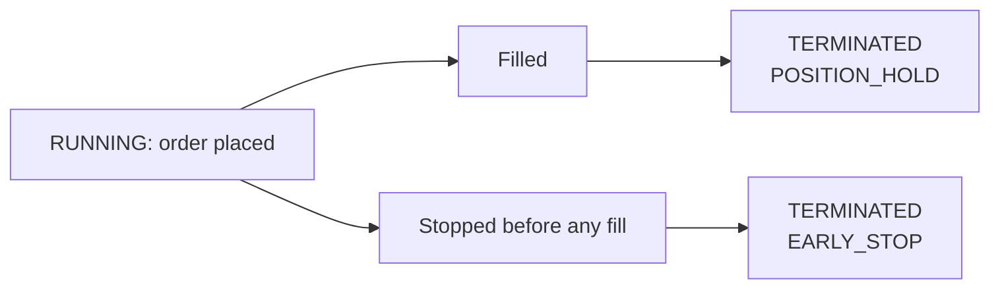

The **Order Executor** places one buy or sell order and stops when the order is filled or cancelled. It has no exit logic: whatever it fills is handed to the agent's inventory as a held position.

It is also how Condor cancels an order (stop the executor) and how it swaps on a DEX (see [DEX swaps](#dex-swaps)).

## Overview

| Property | Value |
|---|---|
| Markets | Spot, perpetuals, and DEX swaps through Gateway |
| Condor tool | `create_order_executor` |
| Exit logic | None. A filled order always ends as `POSITION_HOLD`. |
| `keep_position` | Not a config field. Fills are always kept, even when you stop with `keep_position=false`. |

## Create one from Condor

Agents and the Condor chat use the `create_order_executor` tool:

```python
create_order_executor(
    connector_name="binance",
    trading_pair="ETH-USDT",
    side=1,
    amount="0.5",
    execution_strategy="LIMIT",
    price=3200.0,
    controller_id="my_agent.my_loop_1",
)
```

This places a limit buy for 0.5 ETH at 3200. In an agent session, `controller_id` must be the session ID (see [Session IDs](/trading-agents/sessions#session-ids)). In the chat you can leave it out, and it defaults to `main`.

### Parameters

| Parameter | Required | Meaning |
|---|---|---|
| `connector_name` | Yes | Exchange connector, such as `binance` or `binance_perpetual`. For a DEX swap, a network such as `solana-mainnet-beta`. |
| `trading_pair` | Yes | Trading pair, such as `ETH-USDT` |
| `side` | Yes | `1` BUY, `2` SELL |
| `amount` | Yes | Order size in the **base** asset, as a string, such as `"0.5"` |
| `execution_strategy` | Yes | `MARKET`, `LIMIT`, `LIMIT_MAKER` or `LIMIT_CHASER`. See [Execution strategies](#execution-strategies). |
| `price` | For `LIMIT` and `LIMIT_MAKER` | Limit price |
| `chaser_distance` | For `LIMIT_CHASER` | How far from the best price to rest the order, as a fraction (`0.001` is 0.1%) |
| `chaser_refresh_threshold` | For `LIMIT_CHASER` | How far the price must move away before the order is re-posted, as a fraction |
| `leverage` | No | Leverage for perpetuals. Default `1`. |
| `position_action` | No | `OPEN`, `CLOSE` or `NIL`. Default `OPEN`. Use `CLOSE` to reduce a perpetual position in HEDGE mode. |
| `level_id` | No | Optional tag for your own bookkeeping |
| `account_name` | No | Account to trade from. Default `master_account`. |
| `controller_id` | No | The tag that owns the executor. Default `main`. An agent passes its session ID. |
| `save_as_default` | No | Save these arguments as your defaults for order executors. See [Saved defaults](/executors/overview#saved-defaults). |

Condor refuses a `LIMIT` or `LIMIT_MAKER` call without a `price`, and a `LIMIT_CHASER` call without both chaser settings, before anything is sent.

## Execution strategies

| Strategy | Order placed | Notes |
|---|---|---|
| `MARKET` | Market order | Fills now at the best available price |
| `LIMIT` | Limit order at `price` | Can fill as a taker if `price` crosses the book |
| `LIMIT_MAKER` | Post-only order at `price` | A buy is placed at `price` or the best bid, whichever is lower; a sell at `price` or the best ask, whichever is higher. The exchange rejects it if it would fill immediately. |
| `LIMIT_CHASER` | Post-only order `chaser_distance` away from the best price | When the price moves away from the order by more than `chaser_refresh_threshold`, the executor cancels it and posts a new one. Only the unfilled remainder is re-posted. |

Example of a chaser that rests 0.1% below the best bid and re-posts when the market moves 0.05% away:

```python
create_order_executor(
    connector_name="binance",
    trading_pair="BTC-USDT",
    side=1,
    amount="0.01",
    execution_strategy="LIMIT_CHASER",
    chaser_distance=0.001,
    chaser_refresh_threshold=0.0005,
)
```

## DEX swaps

Set `connector_name` to a network and `execution_strategy` to `MARKET` to swap through Gateway. The route comes from the network's configured swap provider.

```python
create_order_executor(
    connector_name="solana-mainnet-beta",
    trading_pair="SOL-USDC",
    side=2,
    amount="0.5",
    execution_strategy="MARKET",
)
```

This sells 0.5 SOL for USDC. On a Gateway connector the executor retries a swap that fails on slippage with a wider tolerance, up to a ceiling (see [Via the API](#via-the-api)). The executor's `custom_info` carries the on-chain `transaction_hash`.

## Via the API

Create the executor with `POST /executors/`. `side` is the number `1` or `2`; `amount` is in the base asset.

```bash
curl -u YOUR_USERNAME:YOUR_PASSWORD -X POST http://localhost:8000/executors/ \
  -H "Content-Type: application/json" \
  -d '{
    "account_name": "master_account",
    "controller_id": "main",
    "executor_config": {
      "type": "order_executor",
      "connector_name": "binance",
      "trading_pair": "ETH-USDT",
      "side": 1,
      "amount": "0.5",
      "execution_strategy": "LIMIT",
      "price": "3200"
    }
  }'
```

For `LIMIT_CHASER`, send `"chaser_config": {"distance": "0.001", "refresh_threshold": "0.0005"}` instead of `price`.

The API also accepts these settings, which the Condor tool doesn't expose. They apply to Gateway swaps only:

| Setting | Default | Meaning |
|---|---|---|
| `slippage_pct` | `0.05` | Starting slippage tolerance, in percent |
| `slippage_multiplier` | `5` | How much the tolerance widens after each failure caused by slippage. Must be greater than 1. |
| `max_slippage_pct` | `5` | The most the tolerance can widen to, in percent |

## Lifecycle



| How it ends | Close type |
|---|---|
| The order fills | `POSITION_HOLD` |
| You stop it after a partial fill | `POSITION_HOLD`, holding the part that filled |
| You stop it before anything fills | `EARLY_STOP` |
| It runs out of retries after failed orders | `POSITION_HOLD` if anything filled, otherwise `FAILED` |
| The account can't fund it | `INSUFFICIENT_BALANCE` |

To cancel a resting order, stop the executor with `stop_executor` (or `POST /executors/{executor_id}/stop`). An order executor can't unwind a fill, so stopping it with `keep_position=false` still keeps whatever filled.

## Position handover

Because every fill ends as `POSITION_HOLD`, the filled amount is added to the Position Hold for the executor's account, connector, trading pair and `controller_id`. An order executor reports no P&L of its own: its `net_pnl_quote` is always 0. Profit and loss is tracked in the Position Hold, where a later sell nets against an earlier buy. See [Position Handover](/executors/position-handover) and [Inventory](/trading-agents/inventory).

This makes the order executor the usual way to build a position in steps, or to exit a held one.

## Learn more

- [Executors overview](/executors/overview): lifecycle, close types and the API
- [Position Executor](/executors/position-executor): one entry with a managed exit
- [MCP Tools](/trading-agents/mcp-tools): `create_order_executor` and `stop_executor`
