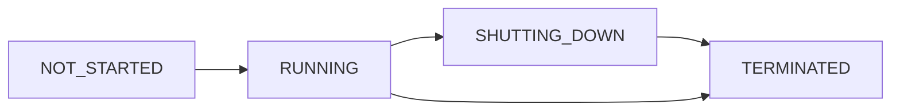

An **executor** is a self-contained trading operation that runs inside the Hummingbot API. It places and manages its own orders, from entry to exit, and reports its P&L, fees and volume in the same shape whatever its type.

Every executor carries a `controller_id`, the tag that owns it. The default is `main`. In a Condor agent session, it is the session ID, such as `my_agent.my_loop_3`, so every executor can be traced to the run that opened it. See [Session IDs](/trading-agents/sessions#session-ids).

## Executors and Condor agents

Condor agents trade through executors. The agent decides once per tick; the executor handles orders and exits between ticks.

In an agent session, the risk gate binds executors to the session:

- An executor create must carry the session's ID as `controller_id`, or it is refused.
- `stop_executor` is refused on an executor that belongs to another session.
- Each tick shows the agent only this session's executors and held positions.

`list_executors` is not limited this way: without a `controller_ids` filter, it lists every executor on the server. See [Risk engine](/trading-agents/architecture#risk-engine).

## Executor types

| Executor | What it does | Create from Condor |
|---|---|---|
| [Order Executor](/executors/order-executor) | Places one order with a chosen execution strategy | `create_order_executor` |
| [Position Executor](/executors/position-executor) | One entry, then a take profit, stop loss, trailing stop or time limit | `create_position_executor` |
| [Grid Executor](/executors/grid-executor) | Evenly spaced levels across a range, each with its own take profit | `create_grid_executor` |
| [DCA Executor](/executors/dca-executor) | A ladder of entries with one exit on the average price | `create_dca_executor` |
| [LP Executor](/executors/lp-executor) | A concentrated-liquidity position on a CLMM DEX | `create_lp_executor` |
| [TWAP Executor](/executors/twap-executor) | One large order split into equal orders over time | API only |
| [XEMM Executor](/executors/xemm-executor) | A limit order on one exchange, hedged at market on another | API only |
| [Arbitrage Executor](/executors/arbitrage-executor) | A market buy and sell on two markets when the gap pays | API only |

<Note>
Condor can create only five executor types: order, position, grid, DCA and LP. TWAP, XEMM and arbitrage executors have no Condor tool, so agents and the Condor chat can't open them. Create those through the Hummingbot API with `POST /executors/`.
</Note>

## Creating executors from Condor

Each creatable type has its own tool. The parameters are flat and typed, and enums are numbers:

| Field | Values |
|---|---|
| `side` | `1` BUY, `2` SELL. The LP executor also takes `3` (both tokens). |
| Order types | `1` MARKET, `2` LIMIT, `3` LIMIT_MAKER |
| `execution_strategy` (order executor), `mode` (DCA executor) | Strings: `MARKET`, `LIMIT`, `LIMIT_MAKER`, `LIMIT_CHASER`; `MAKER`, `TAKER` |

Every create tool also takes `account_name` (default `master_account`), `controller_id` (default `main`) and `save_as_default`.

Before Condor sends a create, it runs two checks:

- **Exchange minimums.** It reads the market's trading rules and refuses an order below the minimum order size or minimum order value, saying what the minimum is.
- **Balance, spot only.** It refuses a spot executor the account visibly can't fund, after re-reading balances to rule out a stale cache. Perpetuals are left to the executor's own start-up check.

After the create, Condor watches the new executor for about 3 seconds. If it ended at once with `INSUFFICIENT_BALANCE` or `FAILED`, the tool reports an error and says nothing was opened. Otherwise it reports how much has filled. "Nothing filled yet" means the entry isn't confirmed: check with `get_executor` before treating the position as open.

### Saved defaults

Condor keeps your default settings per executor type in `~/.hummingbot_mcp/executor_preferences.md`, on the machine that runs Condor's Hummingbot MCP server. Every create merges these defaults **under** the arguments you pass: they fill in what you left out and never override what you set. A create with `save_as_default=true` saves its arguments there.

Read and change the file with the `executor_defaults` tool: `get` returns it, `save` replaces it, and `reset` restores the template but keeps the values already saved.

<Warning>
The file Condor writes on first use already sets grid defaults, including `keep_position: true` and `take_profit: 0.0002`. A grid created from Condor uses them unless you pass those parameters. See [Grid Executor](/executors/grid-executor#parameters).
</Warning>

## Lifecycle



| Status | Meaning |
|---|---|
| `NOT_STARTED` | Created, not running yet |
| `RUNNING` | Placing and managing orders |
| `SHUTTING_DOWN` | An exit or a stop is in progress: cancelling orders, closing the position |
| `TERMINATED` | Finished. `close_type` says how. |

When an executor starts, it checks the account can fund it. If not, it terminates at once with `INSUFFICIENT_BALANCE`.

Executors run in the Hummingbot API's memory. If the API restarts, executors that were running don't resume: they are recorded as `TERMINATED` with close type `SYSTEM_CLEANUP`.

### Close types

| Close type | Meaning |
|---|---|
| `TAKE_PROFIT` | The take profit triggered. For a grid, the price left the range on the winning side. |
| `STOP_LOSS` | The stop loss triggered. For a grid, also the price crossing `limit_price` with `keep_position` false. |
| `TRAILING_STOP` | The trailing stop triggered |
| `TIME_LIMIT` | The time limit passed |
| `EXPIRED` | The time limit had already passed when the executor started |
| `EARLY_STOP` | Stopped with `keep_position=false`, or with `keep_position=true` when there was nothing to keep |
| `POSITION_HOLD` | Ended with its position kept. See [Position Handover](/executors/position-handover). |
| `COMPLETED` | Finished its job: a TWAP's orders all filled (a stopped TWAP also ends here), or an arbitrage's two orders filled |
| `INSUFFICIENT_BALANCE` | The account couldn't fund it at start |
| `FAILED` | Ran out of retries, or failed to start |
| `SYSTEM_CLEANUP` | Set by the Hummingbot API, not the executor: it was running when the API restarted |

A filled order executor always ends as `POSITION_HOLD`, never `COMPLETED`.

## Stopping an executor

Stop an executor with the `stop_executor` tool or `POST /executors/{executor_id}/stop`. Both take `keep_position`, default `false`:

- `false`: cancel open orders and close what the executor holds, where the type supports it.
- `true`: cancel open orders and keep the position. The executor ends as `POSITION_HOLD`.

Stopping an executor that has already terminated is not an error: the API returns its final close type.

`keep_position` is also a **config** field on the grid and LP executors, where it decides what happens when the executor closes itself. Everywhere else it exists only as a stop parameter. See [Position Handover](/executors/position-handover).

## Via the API

| Action | Request |
|---|---|
| Create | `POST /executors/` with `account_name`, `controller_id` and `executor_config` (which includes `"type"`) |
| List and filter | `POST /executors/search` |
| Get one | `GET /executors/{executor_id}` |
| Stop | `POST /executors/{executor_id}/stop` with `{"keep_position": false}` |
| Config schema for a type | `GET /executors/types/{executor_type}/config` |
| Held positions | `GET /executors/positions/summary?controller_id=...` |
| Aggregate performance | `GET /executors/performance?controller_id=...` |

List one session's running executors:

```bash
curl -u YOUR_USERNAME:YOUR_PASSWORD -X POST http://localhost:8000/executors/search \
  -H "Content-Type: application/json" \
  -d '{"controller_ids": ["my_agent.my_loop_3"], "status": "RUNNING", "limit": 50}'
```

Stop one and close its position:

```bash
curl -u YOUR_USERNAME:YOUR_PASSWORD -X POST http://localhost:8000/executors/EXECUTOR_ID/stop \
  -H "Content-Type: application/json" \
  -d '{"keep_position": false}'
```

Each executor page has a full create body.

## What every executor reports

| Field | Meaning |
|---|---|
| `status` | `RUNNING`, `TERMINATED` and so on |
| `close_type` | How it ended, or `null` while running |
| `net_pnl_quote` | Net P&L in the quote asset, after fees |
| `net_pnl_pct` | Net P&L as a fraction (`0.01` is 1%) |
| `cum_fees_quote` | Fees paid, in the quote asset |
| `filled_amount_quote` | Volume traded, in the quote asset |
| `controller_id` | The tag that owns it |
| `error_count` / `last_error` | Errors logged by the executor |
| `custom_info` | Type-specific detail, such as grid level states or an LP position's range |

An order executor reports 0 P&L: its fills are tracked in the Position Hold instead.

## Learn more

- [Position Handover](/executors/position-handover): what happens to a kept position
- [Inventory](/trading-agents/inventory): how held positions and their P&L are tracked
- [MCP Tools](/trading-agents/mcp-tools): the executor tools and which seats get them
