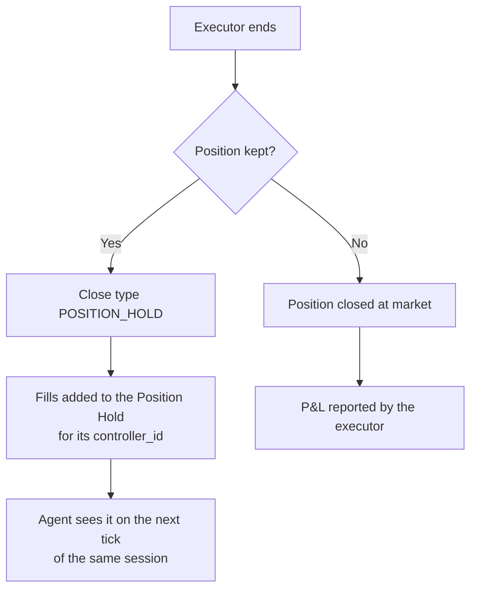

**Position handover** is what happens when an executor ends without closing its position. The executor terminates with close type `POSITION_HOLD`, and the Hummingbot API adds its fills to the **Position Hold** for the executor's account, connector, trading pair and `controller_id`. The tokens stay in the account, and an agent can manage the position later with a new executor.



## When an executor hands over

A handover happens only when an executor ends with `POSITION_HOLD`. `keep_position` is a config field on two executors only, the grid and the LP executor. For every type it is also a parameter of the stop call.

| Executor | Hands over when | Never hands over when |
|---|---|---|
| [Order](/executors/order-executor) | Always, once anything has filled | — |
| [Position](/executors/position-executor) | You stop it with `keep_position=true` after the entry filled | A take profit, stop loss, trailing stop or time limit triggers. These always close at market. |
| [Grid](/executors/grid-executor) | The price crosses `limit_price` and the config's `keep_position` is `true`, or you stop it with `keep_position=true` | The price leaves the range on the winning side, or the time limit passes. A grid `stop_loss` or `trailing_stop` set through the API also always closes, even with `keep_position=true`. |
| [LP](/executors/lp-executor) | It closes itself (a limit price is hit) with the config's `keep_position` `true`, you stop it with `keep_position=true`, or a close keeps failing | — |

When you stop an executor, the `keep_position` you pass with the stop decides. A grid's or LP executor's config value applies only when the executor closes itself.

If there turns out to be nothing to hold (the entry never filled), the executor ends as `EARLY_STOP` instead.

### Executors whose holds are not recorded

The DCA, TWAP, XEMM and arbitrage executors don't hand over to the Position Hold:

- **DCA, XEMM and arbitrage:** a stop with `keep_position=true` ends them as `POSITION_HOLD` and leaves the fills in the account, but the current Hummingbot API doesn't record those fills in the Position Hold.
- **TWAP:** a stopped TWAP always ends as `COMPLETED`, so nothing is handed over.

Anything they leave in the account is invisible to `list_positions_held` and to an agent's held positions. Track it yourself.

## What gets recorded

For each handover, the API adds the executor's filled orders to the Position Hold keyed by:

```text
(account_name, connector_name, trading_pair, controller_id)
```

Buys and sells are added separately. When a hold has both, the matched amount becomes realized P&L and only the unmatched amount stays open. See [Inventory](/trading-agents/inventory) for the fields and the P&L arithmetic.

For an LP executor the connector is the network, such as `solana-mainnet-beta`, and the executor records one net trade for the whole position. See [LP Executor](/executors/lp-executor#what-gets-recorded).

## Held positions belong to one session

The `controller_id` in the key is the agent session's ID, such as `my_agent.my_loop_3`. So:

- On each tick, the agent sees the held positions for its own session ID only.
- A new session of the same loop has a new ID, and can't see what an earlier session held.

Before you stop a loop that holds positions, close them or decide to manage them by hand. See [Executors stay with the session that opened them](/trading-agents/sessions#executors-stay-with-the-session-that-opened-them).

## Example: a grid that crosses its limit price

An agent runs a long grid that holds what it bought if SOL falls through 138:

```python
create_grid_executor(
    connector_name="binance",
    trading_pair="SOL-USDT",
    side=1,
    start_price=140,
    end_price=150,
    limit_price=138,
    total_amount_quote=500,
    take_profit=0.002,
    keep_position=True,
    leverage=1,
    controller_id="my_agent.my_loop_3",
)
```

1. SOL falls to 138. The grid cancels its open orders and ends as `POSITION_HOLD`.
2. The SOL it bought and hadn't sold yet is added to the Position Hold for `(master_account, binance, SOL-USDT, my_agent.my_loop_3)`.
3. On the next tick, the agent sees the held SOL with its breakeven price.
4. When it decides to exit, it sells with an order executor under the same `controller_id`:

```python
create_order_executor(
    connector_name="binance",
    trading_pair="SOL-USDT",
    side=2,
    amount="2.5",
    execution_strategy="LIMIT",
    price=145.0,
    controller_id="my_agent.my_loop_3",
)
```

When the sell fills, the order executor hands it over too. It nets against the held buys in the same Position Hold, and the matched amount becomes realized P&L.

## Positions add up

Every handover under the same key adds to one position:

```text
Order executor: buy 10 SOL at $150
Order executor: buy  5 SOL at $145
Grid level:     buy  5 SOL at $140

Position Hold: long 20 SOL, buy breakeven $146.25
```

## Clearing a held position

If a held position was closed somewhere else, such as on the exchange's own site, clear the record with `clear_position_held` or `DELETE /executors/positions/{connector_name}/{trading_pair}`. Pass the position's `controller_id` and `account_name`: they default to `main` and `master_account`. This changes only the record; it moves no funds. To close a position that is still open, trade it with an executor.

## Related

- [Inventory](/trading-agents/inventory): the Position Hold fields and P&L
- [Executors overview](/executors/overview): stop calls and close types
