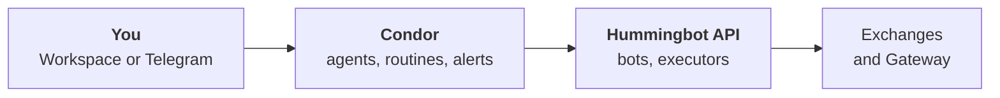
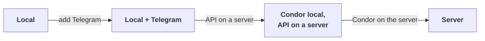

import FeedbackSurvey from "/snippets/feedback-survey.mdx";

Condor uses a [two-server architecture](/motivation): the **Condor Server** (agentic layer) and the **Hummingbot API Server** (execution layer). One installer sets up both.



## Prerequisites

- **[Docker](https://docs.docker.com/get-docker/)**, installed and running, on the machine that runs Hummingbot API.
- A machine that meets the requirements below.
- **Telegram mode only:** a bot token and your Telegram user id. See [Create a Telegram Bot](#create-a-telegram-bot).
- **Server installs only:** a [Tailscale](https://tailscale.com) account. See [Secure Remote Access with Tailscale](#secure-remote-access-with-tailscale).

<AccordionGroup>
  <Accordion title="System requirements">
    | Component | Minimum | Recommended |
    |-----------|---------|-------------|
    | OS | Linux x64 or ARM (Ubuntu 20.04+), macOS, or Windows with WSL2 (Ubuntu) | Ubuntu 22.04 LTS |
    | Memory | 4 GB RAM | 8 GB RAM |
    | Storage | 10 GB SSD | 20 GB SSD |
    | CPU | 2 vCPUs | 4 vCPUs |
  </Accordion>
  <Accordion title="Cloud server options">
    Any cloud provider works. Popular choices:
    - **AWS EC2**: t3.medium or larger
    - **Google Cloud**: e2-medium or larger
    - **Digital Ocean**: Basic Droplet with 4GB RAM
    - **Hetzner**: CX21 or larger

    Allow **SSH (port 22)** for administration. **Do not expose port 8000 publicly**. Use [Tailscale](#secure-remote-access-with-tailscale) so Condor and other clients reach the API at `http://hummingbot-api:8000` on your private tailnet.
  </Accordion>
</AccordionGroup>

## Choose your install

Three paths. All three run the same agents, bots, routines and Workspace. What differs is who can reach them and where alerts go.

<CardGroup cols={3}>
  <Card title="Local" icon="laptop" href="#local">
    Your own machine, no Telegram account. Workspace only, no login.
  </Card>
  <Card title="Local + Telegram alerts" icon="bell" href="#local-with-telegram-alerts">
    Your own machine, plus a bot that pushes alerts to your phone.
  </Card>
  <Card title="Server" icon="server" href="#server">
    A VPS running 24/7. Telegram from anywhere, and the Workspace over Tailscale.
  </Card>
</CardGroup>

| | **Local** | **+ Telegram** | **Server** |
|---|---|---|---|
| **You need** | Nothing extra | Bot token, user id | The same, plus Tailscale |
| **Login** | None | Telegram | Telegram, inside your tailnet |
| **Alerts** | Workspace bell | Telegram and bell | Telegram and bell |
| **Runs 24/7** | No | No | Yes |
| **Best for** | Trying it out | Most people | Real capital |

You can switch later. See [Start local, grow later](#start-local-grow-later).

### Local

No bot, no token, no Telegram account. The Workspace runs on the machine you installed on, at `http://localhost:8088`, and you are already logged in when you open it.

<Warning>
  **Local mode has no login.** Anyone who can reach the port has full trading control.

  - It binds **`127.0.0.1`** only: reachable from that machine, nowhere else. Turning Tailscale on does not change this.
  - To use it from another machine, open an SSH tunnel (`ssh -L 8088:localhost:8088 you@host`, then browse `http://localhost:8088`), or switch to Telegram mode.
  - Exposing it takes an explicit **`WEB_HOST=0.0.0.0`** in `.env`. Only do that behind something that authenticates, such as an authenticating reverse proxy.
</Warning>

Alerts (finished routines and delegations, agent notices, update notices) land in the Workspace's notification bell. To get them as system notifications when no Condor tab is open, turn on [Settings → Notifications](/webui/settings#notifications) in each browser. Approval requests appear only in the Workspace chat that asked, and a request nobody answers is denied after 2 minutes.

### Local with Telegram alerts

The same install, with a bot attached. You control Condor with commands (`/portfolio`, `/trade`, `/agent`), alerts reach your phone through Telegram, and `/web` gives you a time-limited link to the Workspace. A chat you start in Telegram also asks for its approvals in Telegram, so you can answer them away from the machine.

### Server

Condor and Hummingbot API on a VPS, running whether or not your laptop is on.

- **[Tailscale](#secure-remote-access-with-tailscale) is required.** Hummingbot API binds `127.0.0.1` by default, so your laptop can't reach it on a VPS. Tailscale gives your devices a private path without opening a public port.
- Use Telegram mode. The Workspace then listens on the server's tailnet address, at `http://<tailnet-ip>:8088`. Local mode on a server stays on `127.0.0.1`, so you could reach it only through an SSH tunnel.
- Run `make doctor` on the VPS after setup. It catches a public bind before it matters.

## Quick Install

<Tabs>
  <Tab title="Quick Start">
    From an empty directory:

    ```bash
    curl -fsSL https://raw.githubusercontent.com/hummingbot/deploy/main/setup.sh | bash
    ```
  </Tab>
  <Tab title="Hummingbot API only">
    Use this **only** to install the API and database stack **by itself**: for example, the Quick Start script did not install Hummingbot API, or you are deploying the API on a **separate** machine. **Docker** must be running on that host first.

    ```bash
    curl -fsSL https://raw.githubusercontent.com/hummingbot/deploy/main/setup.sh | bash -s -- --hummingbot-api
    ```

    On a VPS or remote server, **enable Tailscale when prompted** (answer **`y`**) so Condor and other clients can reach the API privately.
  </Tab>
  <Tab title="Manual install">
    Prefer **Quick Start**. Use manual install **only** if the deploy script fails or you are setting up from source, for example for development.

    Clone the Condor repo and use the Makefile. You still need a running **Hummingbot API** (for example [Docker with hummingbot-api](https://github.com/hummingbot/hummingbot-api)) unless you already have one.

    ```bash
    git clone https://github.com/hummingbot/condor.git
    cd condor

    make install     # Interactive setup + dependencies + AI CLI tools
    make run         # Start the bot
    ```
  </Tab>
</Tabs>

### What the installer asks

<Steps>
  <Step title="How you will use Condor">
    **Telegram** or **Local**. See [Choose your install](#choose-your-install). In Telegram mode it then asks for your **bot token** and **Telegram user id**.
  </Step>
  <Step title="Tailscale, yes or no">
    Answer **`y`** for a server or any remote setup. You paste the `tskey-auth-...` key later, when it is needed. In Telegram mode, Tailscale also puts the Workspace on your tailnet; in Local mode the Workspace stays on `127.0.0.1` either way.

    In Telegram mode without Tailscale, it also asks for a **public IP or hostname**. Press Enter if Condor runs on your own machine, or give the server's public address so `/web` links work from your phone.
  </Step>
  <Step title="AI model">
    The wizard first sets up Condor's Python environment. On a first install this downloads about 250MB and takes 1–3 minutes. Then it asks **Pick an AI model now?** Answer yes to choose one and install its CLI bridge, or skip and run `make pick-model` later. See [Integrating your LLM](/llm-integration).
  </Step>
  <Step title="Hummingbot API">
    Whether to **configure and launch Hummingbot API** with Docker. Answer **yes** if Condor and the API run on the same machine. If the API runs on another server, skip this and enter that API's URL. If an API is already running on port 8000, the wizard offers to keep it and asks for its credentials.

    If you said yes to Tailscale, paste your `tskey-auth-...` key from the [Tailscale admin console](https://login.tailscale.com/admin/settings/keys). When Condor deploys the API on this same machine, it also asks whether the API should get its **own** tailnet node. Answer **no** unless another device needs to reach the API directly.
  </Step>
  <Step title="Hummingbot API credentials">
    An admin **username**, **password** and **config password**. They are required and have no defaults. Whatever you enter is written to the API's `.env` and to Condor's `config.yml`, so the two sides match.
  </Step>
</Steps>

<Tip>
  **`make install` finishes by running `make doctor`.** A warning there never fails the install, so read the report rather than trusting a clean exit. Run `make doctor` again any time: it is read-only and re-checks dependencies, `.env` and `config.yml`, the AI model, the Workspace's network binding, Tailscale, and whether each Hummingbot API server is reachable **and** authenticating.
</Tip>

## Verify Installation

Run `make doctor` first. It exits non-zero only if something is actually broken.

<Tabs>
  <Tab title="Local mode">
    Open `http://localhost:8088` in a browser on the machine running Condor. You are logged in already, with no token or login screen.
  </Tab>
  <Tab title="Telegram mode">
    Open your Telegram bot and send `/start`. If your id is `ADMIN_USER_ID`, or an admin has approved you, the bot replies with a short introduction and its main commands:

    ```text
    I can help you create and manage trading bots on any CEX or DEX using Hummingbot API servers.

    See this manual if you're new to Condor.

    You can control me by sending these commands:

    /keys - add exchange API keys
    /portfolio - view balances across exchanges
    /bots - deploy and manage trading bots
    /trade - place CEX and DEX orders
    /agent - AI trading assistant
    /web - open the web dashboard
    ```

    A new user gets **Access Request Submitted** instead, and the admin is notified to approve them.
  </Tab>
</Tabs>

<Note>
  Each time Condor starts, the admin gets **"Condor is online and ready."** followed by the branch and commit it is running: in the Workspace's notification bell, and in Telegram mode as a Telegram message too. If it does not appear within a minute or two, see [Troubleshooting](/getting-started/troubleshooting).
</Note>

<Card title="Next: Adding Credentials" icon="arrow-right" href="/getting-started/credentials">
  Connect your exchange accounts
</Card>

## Start local, grow later

The common route is to start with **Local**, attach **Telegram** once you want alerts on your phone, and involve a **server** once real capital is on the line. Each hop keeps what you have built.



The Telegram/Local choice is stored as `CONDOR_MODE` in `.env` (`telegram` or `local`). To switch, re-run `make setup` and pick the other mode. Your `TELEGRAM_TOKEN` is left in place, so switching back costs nothing. "Server" is not a mode; it is where you run one of the two.

### Add Telegram to a Local install

1. Create a bot and get your numeric user id. See [Create a Telegram Bot](#create-a-telegram-bot).
2. Run `make setup`. It shows the current mode and asks **Keep local mode?** Answer `n`, pick **Telegram**, then enter the token and your id. Everything else is remembered.
3. Run `make restart`, then send `/start` to your bot.

<Note>
  A Local install that never had Telegram runs as user id **1**. Adding a bot switches your login to your Telegram id. The API **servers** you configured carry over, but Workspace **preferences and agent conversations** are kept per user and stay behind under id 1. Make this hop early. The reverse switch, Telegram → Local, keeps your id and everything with it.
</Note>

### Keep Condor local, put the API on a server

You don't have to move Condor to get 24/7 execution. Bots and executors run on the **Hummingbot API server**, so a laptop Condor driving a VPS API keeps strategies running while the laptop sleeps. Only agents, routines and alerts live in Condor itself.

1. On the VPS, run the **Hummingbot API only** installer and answer **`y`** to Tailscale. See [On the API server](#on-the-api-server).
2. On your machine, install [Tailscale](https://tailscale.com/download) and sign in to the same tailnet.
3. Add the server in **Settings → Servers** in the Workspace, or **`/servers`** in Telegram: host `hummingbot-api`, port `8000`, and the credentials you set on the VPS.
4. Run `make doctor`. The new server should report **reachable, authenticated**.

### Move Condor itself to the server

When you want agents and routines running around the clock too:

1. Install Condor on the VPS ([Quick Install](#quick-install)) in **Telegram mode**, and answer **`y`** to Tailscale. Enter the same admin user id as your current install, because conversations and preferences are keyed to it.
2. Stop the new install (`make stop`) and copy your state over. From the old Condor directory:

   ```bash
   scp config.yml you@vps:condor/   # servers, users, preferences
   scp -r data you@vps:condor/      # notifications, Telegram chat state, backtests
   scp -r .condor you@vps:condor/   # your agents, sessions, memory and conversations
   scp -r reports you@vps:condor/   # routine reports
   ```

   Don't copy `.env`. The VPS's `.env` holds its own mode, Tailscale setting and Workspace address. Copy only values you added yourself, such as LLM provider keys.

   If you set `CONDOR_RUNTIME_ROOT`, `CONDOR_DATA_DIR` or `CONDOR_REPORTS_DIR`, copy those folders instead. See [Storage locations](/getting-started/configuration#storage-locations). If you wrote your own routines in `routines/`, copy those files too.
3. On the VPS, run `make doctor`, then `make run`. If the API now lives on this same VPS, point the server entry at `localhost` in **Settings → Servers** (or **`/servers`**).
4. Retire the old install (`make stop` on the laptop) so two Condors are not driving the same accounts.

## Create a Telegram Bot

<Info>Telegram mode only. Skip this if you chose Local mode.</Info>

1. Open [@BotFather](https://t.me/botfather) in Telegram.
2. Send `/newbot` and follow the prompts to name your bot.
3. Copy the bot token (format: `123456789:ABCdefGHIjklMNOpqrsTUVwxyz`).

### Get Your User ID

1. Open [@userinfobot](https://t.me/userinfobot) in Telegram.
2. Send `/start` to receive your user ID.

## Secure Remote Access with Tailscale

Hummingbot API can place orders, read balances and manage bots, and AI agents make that surface easier to reach. Tailscale puts the API on a private, encrypted network so only your devices can connect, without publishing port **8000** on a public IP. Use strong API passwords too: Tailscale adds network isolation on top of authentication, it doesn't replace it.

For a full walkthrough, see [Securing Condor and Hummingbot API with Tailscale](https://hummingbot.org/blog/securing-condor-and-hummingbot-api-with-tailscale/) and the [Hummingbot API Tailscale guide](https://hummingbot.org/hummingbot-api/tailscale/).

### Do I Need Tailscale?

| Situation | Tailscale needed? |
|-----------|--------------------|
| Condor and Hummingbot API on one machine | No |
| Same VPS, both services together | **No.** The API binds `127.0.0.1` by default. Still worth it if anything ever needs off-box access |
| Different machines (for example, laptop + VPS) | **Yes** |
| A team or multiple devices need access | **Yes** |
| The Workspace from another device, in Telegram mode | **Yes.** See [The Workspace under Tailscale](#the-workspace-under-tailscale) |
| The Workspace from another device, in Local mode | Tailscale does not help. Use an SSH tunnel, or switch to Telegram mode |

### Set up your tailnet

Create a free account at [tailscale.com](https://tailscale.com), then:

1. Generate a **reusable** auth key at [Settings → Keys](https://login.tailscale.com/admin/settings/keys) (starts with `tskey-auth-`).
2. Enable **[MagicDNS](https://login.tailscale.com/admin/dns)** so `hummingbot-api` resolves by name.
3. Install Tailscale on every device that should reach the API (your laptop, the Condor host) and sign in to the same account.

### On the API server

1. Run the **Hummingbot API only** installer, or Quick Start with the API enabled.
2. When asked **Use Tailscale for secure private networking?**, answer **`y`**.
3. Paste your auth key and deploy:

```bash
cd hummingbot-api
make deploy
make tailscale-status   # confirm hummingbot-api appears on your tailnet
```

### On the Condor machine

1. Install [Tailscale](https://tailscale.com/download) and sign in to the **same account**.
2. In Telegram, open **`/servers`**, or in Local mode **Settings → Servers** in the Workspace, and add the API with:
   - **Host**: `hummingbot-api` (MagicDNS name, not a public IP)
   - **Port**: `8000`
   - **Username / Password**: same as the API `.env`

Test from the Condor host:

```bash
curl -u YOUR_USERNAME:YOUR_PASSWORD http://hummingbot-api:8000/
```

### The Workspace under Tailscale

**Telegram mode.** With `USE_TAILSCALE=true` in `.env`, Condor binds the Workspace to this machine's tailnet address instead of `0.0.0.0`. You reach it at `http://<tailnet-ip>:8088` from any device on your tailnet, and from nowhere else. The installer writes that address to `WEB_URL`, so `/web` links point to it.

If Condor can't find the tailnet address at startup (for example, Tailscale is not up yet), it binds `127.0.0.1` instead. It never falls back to a public bind. It then tries `tailscale serve`, and logs an error if it can't confirm that either. Fix Tailscale, then restart Condor so it picks up the tailnet address:

```bash
tailscale status   # is this machine on the tailnet?
make doctor        # warns when the Workspace is on loopback instead of the tailnet address
make restart
```

**Local mode.** Tailscale changes nothing. The Workspace has no login, so it stays on `127.0.0.1` whether or not Tailscale is on.

<Warning>
  Do not set `WEB_HOST=0.0.0.0` to "fix" an unreachable Workspace. That publishes a login-free interface in Local mode, and a login-link one in Telegram mode, to every network the machine is attached to. `make doctor` reports it as a failure in Local mode, and in Telegram mode with Tailscale on.
</Warning>

<Note>
  Browser notifications (**Settings → Notifications**) need a secure connection: `localhost` or HTTPS. They don't work at a plain `http://<tailnet-ip>:8088` address, so on a server you get alerts through Telegram.
</Note>

### What binds where by default

Every port in the Hummingbot API stack is on loopback out of the box. The only exception is Condor's own Workspace, and only in Telegram mode, which authenticates.

| Service | Port | Default bind | Setting |
|---------|------|--------------|------|
| Hummingbot API | `8000` | `127.0.0.1` | `API_BIND` in `hummingbot-api/.env` |
| PostgreSQL | `5432` | `127.0.0.1` | `DB_BIND` in `hummingbot-api/.env` |
| EMQX broker (MQTT) | `1883` | `127.0.0.1` | not configurable |
| EMQX dashboard | `18083` | `127.0.0.1` | not configurable |
| Condor Workspace | `8088` | Local mode: `127.0.0.1`. Telegram mode: `0.0.0.0`, or the machine's tailnet address with Tailscale on | `WEB_HOST` in `condor/.env` |

EMQX's other listeners (`8883`, `8083`, `8084`, `8081`, `61613`) are not published at all. None of this replaces the credentials: a loopback bind protects the port, not the machine.

<Warning>
  **Installed before the API's port lockdown? Check it.** Hummingbot API used to publish port **8000 on every interface**, including a VPS's public IP. It now binds `127.0.0.1` by default (`${API_BIND:-127.0.0.1}` in `docker-compose.yml`), and so do Postgres and the EMQX broker. An existing stack keeps its old bindings until the containers are recreated. Run `make deploy` in `hummingbot-api`, then `make doctor`, which flags any of those ports still on a public interface.

  If you *do* need the API reachable off-box, widen it deliberately with `API_BIND` in `hummingbot-api/.env`. Prefer a specific interface over `0.0.0.0`; with Tailscale, `API_BIND=<your-tailscale-ip>` keeps MagicDNS working without publishing anything to the internet. Docker's published ports are *not* blocked by `ufw`: Docker's rules are evaluated first, so `ufw deny 8000` leaves a widened port reachable unless you write `DOCKER-USER` rules yourself. Close the port in your cloud provider's firewall instead, which is enforced off-host.
</Warning>

## Managing Services

Both installs run Condor in a **tmux** session named `condor`. From the Condor directory, the Makefile wraps the common operations:

```bash
make run       # start (fails fast and prints the error if startup dies)
make logs      # attach to the session (detach: Ctrl+B, then D)
make status    # is Condor running?
make restart   # stop and start again
make stop      # stop Condor
make run-fg    # run in the foreground instead, for debugging a startup error
make doctor    # re-check dependencies, config, and API access
```

After Quick Start you can also use tmux directly (`tmux attach -t condor`, `tmux kill-session -t condor`), and upgrade from the directory that contains the `condor` folder:

```bash
curl -fsSL https://raw.githubusercontent.com/hummingbot/deploy/main/setup.sh | bash -s -- --upgrade
```

For Hummingbot API (Docker), from the `hummingbot-api` directory (next to `condor` when the deploy script installed it):

```bash
make doctor              # containers, port exposure, credentials, Tailscale, API auth
docker compose ps
docker compose logs -f   # or your compose plugin equivalent
make tailscale-status    # when Tailscale is enabled
make emqx-audit          # broker listeners, auth, ACL and any rule-engine rules
```

To update Condor and Hummingbot API, see [Updating Condor](/getting-started/updating). For what Condor sends and how to turn it off, see [Privacy: Telemetry and Sharing](/getting-started/privacy).

### Access Points

| Service | Local URL | Tailnet URL (with Tailscale) | Description |
|---------|-----------|--------------------------------------|-------------|
| Telegram | Your bot | — | Primary interface (Telegram mode) |
| API | `http://localhost:8000` | `http://hummingbot-api:8000` | REST API |
| Swagger | `http://localhost:8000/docs` | `http://hummingbot-api:8000/docs` | API documentation |
| Workspace (Telegram mode) | Run `/web` in Telegram for a link | `http://<tailnet-ip>:8088` (`/web` links use it) | Browser interface, time-limited login link |
| Workspace (Local mode) | `http://localhost:8088` | Not available. Use an SSH tunnel | Browser interface, no login, loopback only |

## Troubleshooting

Condor can't reach the API, Telegram stays quiet, or Tailscale won't connect? See [Troubleshooting](/getting-started/troubleshooting), which also covers [securing the message broker](/getting-started/troubleshooting#secure-the-message-broker).

Got Condor running? Tell us how install went, what's confusing, and what you need next.

<FeedbackSurvey />
