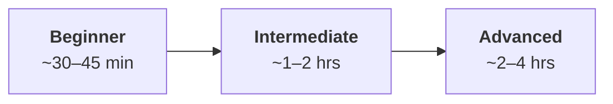
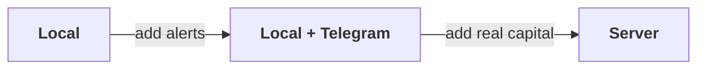
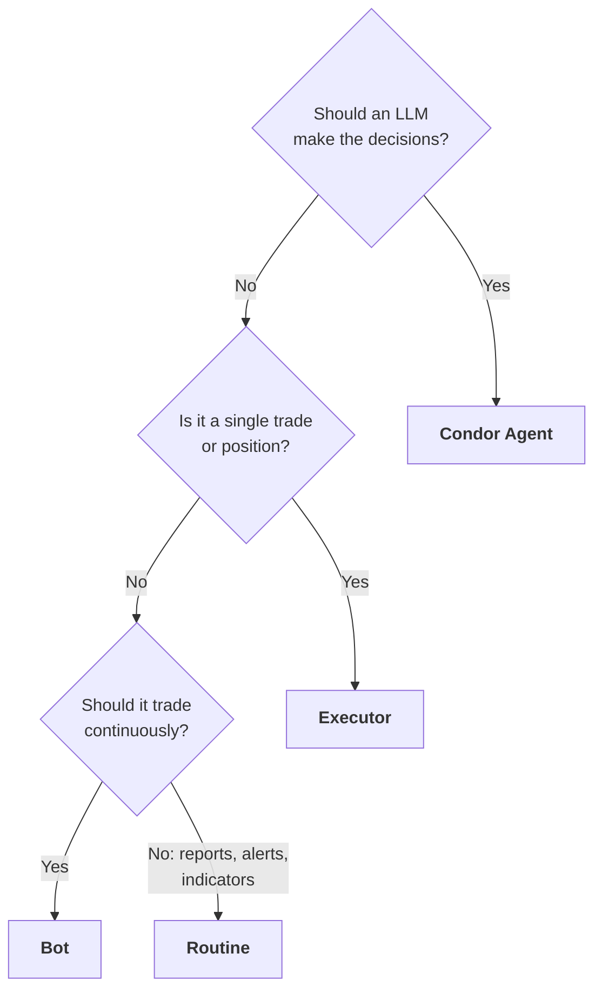

import FeedbackSurvey from "/snippets/feedback-survey.mdx";

New to Condor, or picking up where you left off? Find the route to what you want to do. You don't need to read every page in order.

## By experience level

Each level builds on the one before it.

<Tabs>
  <Tab title="Beginner">
    Get Condor running on your own machine with no Telegram account, and build one Condor Agent from the browser.

    <Steps>
      <Step title="Install locally">
        [Installing → Local](/getting-started/installing#local)
      </Step>
      <Step title="Open the Workspace">
        [Workspace](/getting-started/web-dashboard)
      </Step>
      <Step title="Connect an exchange">
        [Credentials](/getting-started/credentials)
      </Step>
      <Step title="Build an agent">
        [Build Your First Agent](/getting-started/first-agent)
      </Step>
    </Steps>
  </Tab>
  <Tab title="Intermediate">
    Attach Telegram so agents can reach your phone with alerts and approval requests, understand Bots, Executors and Routines, and manage running sessions.

    <Steps>
      <Step title="Add Telegram alerts">
        [Add Telegram to a Local install](/getting-started/installing#add-telegram-to-a-local-install), then [Telegram](/getting-started/telegram)
      </Step>
      <Step title="Learn the building blocks">
        [Bots](/bots/overview), [Executors](/executors/overview) and [Routines](/routines/overview)
      </Step>
      <Step title="Manage running agents">
        [Sessions](/getting-started/sessions)
      </Step>
    </Steps>
  </Tab>
  <Tab title="Advanced">
    Deploy to a VPS behind Tailscale, understand the multi-agent architecture, and build custom agents.

    <Steps>
      <Step title="Install on a server">
        [Installing → Server](/getting-started/installing#server)
      </Step>
      <Step title="Understand the architecture">
        [Condor Agents Architecture](/trading-agents/architecture)
      </Step>
      <Step title="Build custom agents">
        [Agent Builder](/condor-agent/agent-builder)
      </Step>
      <Step title="Connect more servers">
        [Servers](/webui/settings#servers)
      </Step>
    </Steps>
  </Tab>
</Tabs>

## Which install do you want?

All three run the same agents, bots, routines and Workspace. What differs is who can reach them and where alerts go. Most people start local and move up, and re-running `make setup` switches mode at any time.

<CardGroup cols={3}>
  <Card title="Local" icon="laptop" href="/getting-started/installing#local">
    Best for trying it out. Nothing extra needed.
  </Card>
  <Card title="Local + Telegram alerts" icon="bell" href="/getting-started/installing#local-with-telegram-alerts">
    Best for most people. Needs a bot token and your Telegram user id.
  </Card>
  <Card title="Server" icon="server" href="/getting-started/installing#server">
    Best for anything holding real capital. Needs Tailscale too.
  </Card>
</CardGroup>

<Warning>
  **Local mode has no login.** Whoever reaches the port has full trading control, so it only listens on `127.0.0.1`. See [Choose your install](/getting-started/installing#choose-your-install) for the full comparison, and [Start local, grow later](/getting-started/installing#start-local-grow-later) for each hop. Add Telegram early, because a Local install's agent history stays behind when you do.
</Warning>

## What do you want Condor to do?

Condor gives you four ways to execute a trade, from fully autonomous to fully manual. Most people end up combining more than one.

<CardGroup cols={2}>
  <Card title="Condor Agent" icon="robot" href="/trading-agents/overview">
    **Decides:** an LLM, reasoning every tick. 
    **Runs:** long-running and adaptive. 
    **Best for:** an AI-assisted strategy that adapts to conditions.
  </Card>
  <Card title="Bot" icon="gears" href="/bots/overview">
    **Decides:** a script or controller with fixed logic. 
    **Runs:** long-running and fixed. 
    **Best for:** always-on market making or grid trading without AI in the loop.
  </Card>
  <Card title="Executor" icon="bolt" href="/executors/overview">
    **Decides:** you, or an agent, one shot. 
    **Runs:** short-lived, a single operation. 
    **Best for:** a single trade, or a stop-loss and take-profit.
  </Card>
  <Card title="Routine" icon="clock" href="/routines/overview">
    **Decides:** deterministic Python. 
    **Runs:** on a schedule or a trigger. 
    **Best for:** reports, alerts and indicators without LLM cost.
  </Card>
</CardGroup>

## By use case

<AccordionGroup>
  <Accordion title="Let AI manage a strategy for me">
    [Condor Agents Overview](/trading-agents/overview) → [LLM Integration](/llm-integration) → [Build Your First Agent](/getting-started/first-agent) → [Agent Loops](/getting-started/sessions) → [Agent Builder](/condor-agent/agent-builder)
  </Accordion>
  <Accordion title="Run an always-on bot without AI micromanagement">
    [Bots Overview](/bots/overview) → [Controllers](/bots/controllers) or [Scripts](/bots/scripts) → [Backtesting](/bots/backtesting)
  </Accordion>
  <Accordion title="Place a single trade, or set a stop-loss/take-profit">
    [Executors Overview](/executors/overview) → [Order Executor](/executors/order-executor) → [Position Executor](/executors/position-executor)
  </Accordion>
  <Accordion title="Automate reports or alerts on a schedule">
    [Routines Overview](/routines/overview) → [Creating Routines](/routines/creating-routines) → [Reports](/routines/reports)
  </Accordion>
  <Accordion title="Test everything locally before risking capital">
    [Installing](/getting-started/installing) (local install—**Tailscale not required**; **Local mode** skips Telegram entirely) → [Credentials](/getting-started/credentials) → dry-run an agent in [Build Your First Agent](/getting-started/first-agent)
  </Accordion>
  <Accordion title="Deploy for 24/7 production on a server">
    [Installing](/getting-started/installing#secure-remote-access-with-tailscale) (remote install—**Tailscale required**) → [Servers](/webui/settings#servers) → [Agent Loops](/getting-started/sessions)
  </Accordion>
  <Accordion title="Manage many agents or bots as a team or fund">
    [Condor Agents Architecture](/trading-agents/architecture) (multi-agent via `controller_id`) → [Global Routines](/routines/global-routines) → [Servers](/webui/settings#servers)
  </Accordion>
</AccordionGroup>

## Key features

What Condor does, and where each feature is documented.

| Feature | What it does |
|---|---|
| [Condor Agents](/trading-agents/overview) | LLM-driven agents that observe markets, reason about strategy, and execute through Hummingbot API |
| [Agent Builder](/condor-agent/agent-builder) | Build a custom agent — its playbooks, tools and risk limits — without writing the harness |
| [Hummingbot bots](/bots/overview) | Always-on market making, grid and directional strategies via [controllers](/bots/controllers) and scripts, no LLM in the loop |
| [Backtesting](/bots/backtesting) | Replay a controller config against historical candles before it touches capital |
| [Executors](/executors/overview) | Single operations — a trade, a position with stop-loss and take-profit, a grid, a DCA, an LP position — driven by you or an agent |
| [Routines](/routines/overview) | Deterministic Python on a schedule or trigger: indicators, alerts, rebalances. No LLM cost |
| [Reports](/routines/reports) | Build and schedule HTML reports with charts, tables and KPIs, then read them in the Workspace |
| [Research](/trading-agents/mcp-tools) | Ask an agent about markets, positions or a strategy, with your live portfolio as context |
| [Portfolio](/webui/portfolio) | Unified balances, positions and P&L across every connected exchange and chain |
| [Manual trading](/webui/trade) | Place and cancel orders yourself, on CEX or DEX, from Telegram or the Workspace |
| [DEX and liquidity](/webui/dex) | Swaps and concentrated-liquidity positions through [Gateway](/webui/settings#gateway) |
| [Workspace](/getting-started/web-dashboard) | Browser UI for bots, agents, portfolio and a live trade panel covering CEX and DEX |
| [Agent sessions](/getting-started/sessions) | Inspect, steer and stop running agents; see what each one decided and why |
| [Multiple servers](/webui/settings#servers) | Drive several Hummingbot API instances — separate accounts, venues or strategies — from one Condor |
| [Your choice of LLM](/llm-integration) | Claude (through the Claude ACP bridge), Gemini, Codex, Copilot, OpenRouter, a local model via Ollama or LM Studio, or any OpenAI-compatible endpoint |

## Something not working?

Run `make doctor` from the Condor directory. It is read-only, checks your setup end to end, and names the fix for each problem it finds. For anything it doesn't cover, see [Troubleshooting](/getting-started/troubleshooting).

## Next steps

<CardGroup cols={2}>
  <Card title="Introduction" icon="circle-info" href="/introduction">
    What Condor is and who it's for
  </Card>
  <Card title="Motivation" icon="lightbulb" href="/motivation">
    Why Condor is architected this way
  </Card>
  <Card title="GitHub" icon="github" href="https://github.com/hummingbot/condor">
    Source code and issues
  </Card>
  <Card title="Give Feedback" icon="clipboard-list" href="/feedback">
    2-minute survey that shapes the roadmap
  </Card>
</CardGroup>

<FeedbackSurvey />
