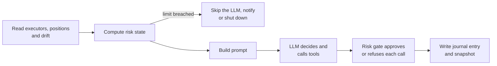

A Trading Agent is a **folder on disk** plus a **tick loop in memory**. The folder holds the agent's identity, its playbooks and its tools. The tick loop reads that folder, asks an LLM what to do, and acts through Hummingbot executors and bots behind a risk gate.

This page covers where to put an agent so Condor loads it, what goes in the folder, and what happens on each tick.

## Where Condor looks for agents

Condor reads agents from **two folders** and merges them:

| Folder | Default location | What it holds | Put your agents here? |
|---|---|---|---|
| **Local** | `<condor>/.condor/agents/` | Agents you create, plus everything Condor writes while running: sessions, journals, memory, edits | **Yes** |
| **Stock** | `<condor>/agents/` | The agents that ship with Condor. Tracked by git and replaced by `git pull` or `/update` | No |

`<condor>` is the folder you installed Condor into. `.condor/` is ignored by git, so nothing you create there is touched by an update.

<Note>
You can move either folder with an environment variable: `CONDOR_AGENTS_ROOT` for the local folder and `CONDOR_STOCK_AGENTS_ROOT` for the stock one. `CONDOR_RUNTIME_ROOT` moves the whole `.condor/` directory. See [Configuration](/getting-started/configuration).
</Note>

The rules Condor follows when it loads agents:

- **An agent is a folder with an `AGENT.md` in it.** Any directory directly under either root counts, unless its name starts with `_`.
- **The folder name is the agent's ID.** It appears in the dashboard URL (`/agents/<slug>`), in Telegram (`/agent <slug>`) and in loop IDs. Use lowercase letters, digits and underscores, for example `my_scalper`. The name `condor` is reserved for the default assistant.
- **Local wins, file by file.** If both folders contain the same file for an agent, Condor uses the local copy. Files you haven't overridden still come from the stock folder, so you keep receiving upstream improvements to everything else.
- **Editing a shipped agent never changes the repo.** The first time you (or an agent) edit a stock file, Condor copies that one file into `.condor/agents/<slug>/` and edits the copy.
- **Shipped files can't be deleted.** An update would bring them back. You can mute a shipped skill or routine instead, which removes it from the agent's runs.
- **No restart needed.** Agents and loops are read from disk each time Condor needs them, so a new folder appears the next time you load the dashboard.

## Folder structure

Everything an agent needs lives under its folder. Files marked *written by Condor* are created at runtime; don't create them yourself.

```text
.condor/agents/
  my_agent/                      # folder name = agent ID
    AGENT.md                     # required: identity, domain knowledge, model, tool allowlist
    shutdown.md                  # optional: emergency-shutdown policy for this agent
    loops/                       # optional: without one, Condor generates a "Default" loop
      my_loop/                   # must match the loop's name (see below)
        loop.md                  # the per-tick playbook and its default config
        config.yml               # written by Condor: saved config overrides
        learnings.md             # written by Condor: lessons kept across sessions
        sessions/                # written by Condor: one folder per Loop run
          session_1/
            journal.md
            snapshots/snapshot_1.md
        dry_runs/                # written by Condor: one file per Dry Run / Run Once
          experiment_1.md
    skills/
      my_skill/
        SKILL.md                 # a playbook the agent reads when it needs it
    routines/
      my_routine.py              # deterministic Python the agent can run
    controllers/                 # optional: Hummingbot V2 controllers this agent deploys
      my_controller/
        my_controller.py
        CONTROLLER.md
        sample_configs/
          balanced.yml
    store/                       # written by Condor: the agent's memory
```

<Warning>
**Name each loop folder after the loop.** Condor lists loops by folder name but writes their sessions to a folder derived from the `name:` in `loop.md`, lowercased with spaces turned into underscores. A loop named `My Loop` must live in `loops/my_loop/`. If the two differ, sessions are written somewhere other than the playbook's folder.
</Warning>

Two shared folders sit beside the agents in either root:

| Folder | Contents |
|---|---|
| `_defaults/` | `core_rules.md`, `reflect.md` and `shutdown.md`, inherited by every agent. A local copy overrides the shipped one, and Condor logs a warning when it does. |
| `_shared/` | `skills/`, `routines/` and `controllers/` available to every agent. An agent's own item with the same name takes precedence. |

## The pieces of an agent

| Piece | File | What it's for | How the agent uses it |
|---|---|---|---|
| **Agent** | `AGENT.md` | Who the agent is and what it knows | Injected into every prompt |
| **Loop** | `loops/<loop>/loop.md` | What to do on each tick, plus default settings | Injected into every tick of that loop |
| **Skill** | `skills/<name>/SKILL.md` | A procedure for a specific job | Listed in the prompt; the agent reads it when needed |
| **Routine** | `routines/<name>.py` | Deterministic data work: scans, indicators, reports | The agent runs it with `manage_routines` |
| **Controller** | `controllers/<name>/` | Strategy code deployed inside a Hummingbot bot | Synced to the server with `manage_agent_controllers` |

One agent can own several loops. They share the agent's skills, routines, controllers and memory. For example, the Market Making Expert has a PMM Mister Operator loop and a HIP-3 MM Operator loop.

### AGENT.md

YAML frontmatter followed by the agent's identity and domain knowledge in Markdown.

```markdown
---
name: My Scalper
description: Scalps SOL-USDT perpetuals on support and resistance.
agent_key: openrouter:deepseek/deepseek-v4.1-flash
tools:
  - get_market_data
  - get_prices
  - create_position_executor
  - list_executors
  - stop_executor
  - manage_routines
  - manage_skill
  - trading_agent_journal_read
  - trading_agent_journal_write
when_to_consult: When the user asks about SOL-USDT scalping setups.
server_required: true
---

# My Scalper

You are a SOL-USDT perpetuals scalper. ...
```

| Field | Default | Meaning |
|---|---|---|
| `name` | the folder name | Display name |
| `description` | — | One-line summary shown in the dashboard |
| `agent_key` | Condor's default model | The model this agent runs on. See [LLM Integration](/llm-integration). |
| `tools` | all tools | Allowlist of tools the agent may call. Leave it empty for no restriction. |
| `when_to_consult` | — | A hint telling Condor when to hand work to this agent |
| `server_required` | `true` | Whether the agent needs a Hummingbot API server |
| `server_name` | the active server | Pins the agent to one server |

### loop.md

Frontmatter with the loop's settings, followed by the instructions for each tick.

```markdown
---
name: My Loop
default_config:
  frequency_sec: 120
  total_amount_quote: 100
  execution_mode: loop
  risk_limits:
    max_position_size_quote: 100
    max_open_executors: 3
  trading_pair: SOL-USDT
default_trading_context: ''
---

# My Loop

Each tick:
1. Run the `my_routine` routine for SOL-USDT.
2. ...
```

| Field | Meaning |
|---|---|
| `name` | Display name. The loop's folder must match it (see the warning above). |
| `description` | Optional summary |
| `agent_key` | Overrides the agent's model for this loop only |
| `default_config` | Session settings and any loop-specific keys. Custom keys, such as `trading_pair` above, are shown to the agent as its current config. |
| `default_trading_context` | Pre-fills the **Trading Context** box in the Start dialog |

The session settings `default_config` accepts:

| Setting | Default | Meaning |
|---|---|---|
| `frequency_sec` | 60 | Seconds between ticks |
| `total_amount_quote` | 100 | Capital the session is meant to use, in the quote asset |
| `execution_mode` | `loop` | `dry_run`, `run_once` or `loop` |
| `tick_timeout_sec` | 0 (10 minutes) | Longest a single tick may run |
| `max_ticks` | 0 (unlimited) | Stop after this many ticks |
| `restart_on_boot` | `false` | Start a fresh session when Condor restarts |
| `risk_limits` | see [Risk engine](#risk-engine) | Limits the risk gate enforces |

<Warning>
`risk_limits` only accepts the fields listed under [Risk engine](#risk-engine). Any other key under `risk_limits` is silently ignored. Put loop-specific limits, such as a minimum wallet balance, at the top level of `default_config` and enforce them in the loop instructions instead.
</Warning>

### SKILL.md

```markdown
---
name: slot_exit
description: Decide whether to hold or exit an open LP position.
when_to_use: When an open position may need to be closed.
---

# Slot exit

1. ...
```

Skills are not loaded into the prompt automatically. The prompt lists each skill's `name` and `when_to_use`, and the agent reads the full skill when it needs it.

### Routines

A routine is a Python file with a Pydantic `Config` class and an async `run` function. It uses the same format as [Condor's general routines](/routines/creating-routines):

```python
from pydantic import BaseModel, Field
from telegram.ext import ContextTypes


class Config(BaseModel):
    """Rank SOL-USDT support and resistance levels."""

    trading_pair: str = Field(default="SOL-USDT", description="Pair to analyze")


async def run(config: Config, context: ContextTypes.DEFAULT_TYPE) -> str:
    return f"Analyzed {config.trading_pair}"
```

An agent can run its own routines and everything in `_shared/routines/`. It cannot run Condor's general routines in the repo's top-level `routines/` folder.

### Controllers

A controller folder holds Hummingbot V2 controller code (`<name>.py`), a `CONTROLLER.md` describing it, and optional sample configs. The folder name must be a valid Python identifier, and no sample config may be named `config.yml`.

The `CONTROLLER.md` frontmatter sets the controller's category, which decides where it is installed on the server:

```markdown
---
type: generic
description: "Layered maker quotes with an inventory band"
---
```

`type` is one of `directional_trading`, `market_making` or `generic`. The agent page's **Controllers** tab shows whether each controller on the server matches the agent's copy.

## What happens on each tick



1. **Read the state.** Condor fetches this session's executors, held positions and any drift between Condor's records and the exchange.
2. **Check the limits.** It computes exposure, executor count and drawdown. A soft drawdown breach skips the tick and notifies you; a hard breach starts an emergency shutdown.
3. **Build the prompt.** `AGENT.md`, the loop instructions, the list of skills and routines, the current config, the risk state and the market data go into one prompt.
4. **Run the LLM.** The agent reasons and calls tools. Every tool call that could move money passes through the risk gate first.
5. **Record it.** Condor appends to the session journal and saves a full snapshot of the tick.

## Risk engine

Each loop session has these limits. Set them in `default_config.risk_limits` or in the Start dialog.

| Limit | Default | Effect |
|---|---|---|
| `max_position_size_quote` | 500 | Total exposure the session may hold, in the quote asset |
| `max_open_executors` | 5 | Executors the session may have open at once |
| `max_drawdown_pct` | -1 (off) | Pauses ticking when drawdown exceeds this |
| `shutdown_drawdown_pct` | -1 (off) | Triggers an emergency shutdown when drawdown exceeds this |
| `max_drift_quote` | -1 (off) | Refuses new exposure while Condor's book and the exchange disagree by more than this |
| `max_leverage` | -1 (off) | Highest leverage an executor or account change may use |

The risk gate also always refuses:

- **Direct orders:** `place_order`. Agents trade through executors and bots.
- **Other sessions' executors:** executors that don't carry this session's ID, and stopping executors owned by another session.
- **Uncapped bots:** a bot deploy without `max_global_drawdown_quote`, or with one above `max_position_size_quote`.
- **Anything in a Dry Run:** every action that would change state, plus running code and routines.

<Note>
Each Loop run gets its own session ID. A new session cannot see or stop executors opened by an earlier session, including after a restart. Stop or hand over positions before starting a new session.
</Note>

## Stopping a loop

| Action | How | What happens to positions |
|---|---|---|
| **Pause / Resume** | Buttons on the agent page | Ticks are skipped; everything stays open |
| **Stop** | **Stop** on the agent page, or ask the agent to stop its loop | The loop ends. Executors, positions and bots **stay open** and are no longer managed. |
| **Emergency shutdown** | Ask the agent to shut its loop down (`control_agent` `shutdown`), or a `shutdown_drawdown_pct` breach | Condor stops this session's executors according to the agent's `shutdown.md` policy, then runs a cleanup pass |

The shutdown policy in `shutdown.md` is one of:

- **`keep_spot_close_perp`** (the default): keep spot holdings, close perpetual positions.
- **`flatten_all`:** close everything.
- **`keep_all`:** stop executors but keep every position.

## Sessions, journals and learnings

Each Loop run writes to `loops/<loop>/sessions/session_N/`:

| File | Contents |
|---|---|
| `journal.md` | Sections: **Summary**, **Decisions**, **Ticks**, **Snapshots**. Older entries move to `journal_archive.md`. |
| `snapshots/snapshot_N.md` | One per tick: **System Prompt**, **Executor State**, **Risk State**, **Agent Response**, **Tool Calls**, **Stats**. The most recent 100 are kept. |

Dry Run and Run Once don't create a session. Each writes one file to `loops/<loop>/dry_runs/experiment_N.md`.

`loops/<loop>/learnings.md` carries lessons across sessions, in **Market Observations**, **Execution Notes** and **Retired Insights** sections. It is capped at 20 entries. You can edit it by hand; the agent treats your entries like its own.

In the dashboard, the agent page shows all of this under **Runs**:

<Frame>
  
</Frame>

## Creating your own agent

There are two ways to create an agent:

- **Ask Condor.** In the dashboard chat or Telegram, describe the agent you want. Condor's `agent_builder` skill writes the folder for you, either from a description or from a folder of your own controllers, configs and notes. See [Agent Builder](/condor-agent/agent-builder).
- **Write the folder yourself.** Create `.condor/agents/<slug>/AGENT.md` and, optionally, a `loops/<loop>/loop.md`. Reload the dashboard and the agent appears under **Agents**.

To share an agent with the Condor project, ask Condor to publish it (`manage_agents` `publish`). That copies it into the stock `agents/` folder, where it can be committed.

<Tip>
To move your agents, sessions and memory to another machine, copy the whole `.condor/` folder.
</Tip>
