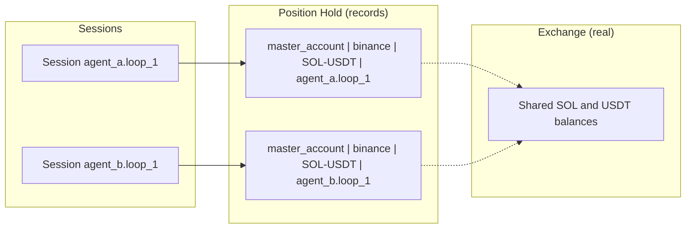

An agent's **inventory** is its **Position Hold**: the positions its executors ended without closing. The Hummingbot API keeps it separately from the exchange balances, so several agents can trade the same pair on the same account and each still has its own position, breakeven price and P&L.

## What goes into the Position Hold

Only executors that end with close type `POSITION_HOLD` add to it. That is:

- every order executor that filled anything;
- a position or grid executor stopped with `keep_position=true`;
- a grid that crossed its `limit_price` with `keep_position: true` in its config;
- an LP executor that closed with `keep_position` true, or whose close kept failing.

An executor that closes its own position (a take profit or stop loss, for example) reports its P&L itself and adds nothing here. For the rules per executor, see [Position Handover](/executors/position-handover).

## How positions are keyed

Each position is identified by four values:

```text
(account_name, connector_name, trading_pair, controller_id)
```

In an agent session, `controller_id` is the session ID, such as `my_agent.my_loop_3` (see [Session IDs](/trading-agents/sessions#session-ids)). So the inventory is **per session**, not per agent: a new session of the same loop starts with an empty inventory, and the agent can't see what an earlier session held.



The connector is the one the executor traded on. For an LP executor that is the network, such as `solana-mainnet-beta`, not the DEX.

## Position fields

| Field | Meaning |
|---|---|
| `buy_amount_base` / `buy_amount_quote` | Open bought amount, in base, and what it cost, in quote |
| `sell_amount_base` / `sell_amount_quote` | Open sold amount, in base, and what it brought in, in quote |
| `net_amount_base` | `buy_amount_base − sell_amount_base`. Positive is long, negative is short. |
| `position_side` | `LONG`, `SHORT` or `FLAT` |
| `buy_breakeven_price` | Average buy price, or `null` with no open buys |
| `sell_breakeven_price` | Average sell price, or `null` with no open sells |
| `matched_amount_base` / `unmatched_amount_base` | Matched buy and sell volume, and the size of the open position |
| `realized_pnl_quote` | P&L from buys and sells that have been matched |
| `unrealized_pnl_quote` | P&L of the open position at the current rate, or `null` when no rate is available |
| `cum_fees_quote` | Fees of all the fills, in quote |
| `executor_ids` / `executor_count` | The executors that contributed |

All amounts are in the base asset and all P&L is in the quote asset.

## How P&L is calculated

Whenever a position has both buys and sells, the API matches them right away:

```text
matched      = min(buy_amount_base, sell_amount_base)
realized_pnl += matched × (average sell price − average buy price)
```

The matched amount is then removed from both sides, so only the open position is left, and the breakeven prices always describe that open position.

For the open position:

```text
Long:  unrealized_pnl = net_amount × (current rate − buy_breakeven_price)
Short: unrealized_pnl = |net_amount| × (sell_breakeven_price − current rate)
```

`realized_pnl_quote` and `unrealized_pnl_quote` don't include fees. Fees are kept in `cum_fees_quote`.

## Example

| Trade | Position after it |
|---|---|
| Buy 100 SOL at $150 | Long 100, buy breakeven $150 |
| Buy 50 SOL at $145 | Long 150, buy breakeven $148.33 |
| Sell 100 SOL at $155 | 100 matched: realized P&L ($155 − $148.33) × 100 = **+$666.67**. Long 50, buy breakeven $148.33. |

## Reading the inventory

From Condor, use `list_positions_held`. Pass `controller_id` to see one session's positions, and both `connector_name` and `trading_pair` for one position's detail.

Through the API:

```bash
# All held positions for one session
curl -u YOUR_USERNAME:YOUR_PASSWORD \
  "http://localhost:8000/executors/positions/summary?controller_id=my_agent.my_loop_3"

# One position
curl -u YOUR_USERNAME:YOUR_PASSWORD \
  "http://localhost:8000/executors/positions/binance/SOL-USDT?controller_id=my_agent.my_loop_3&account_name=master_account"
```

The single-position route defaults to `controller_id=main`, so pass the session ID to read an agent's position. The summary also returns `total_realized_pnl` and `total_unrealized_pnl` across the positions it lists.

A position whose buys and sells have fully matched no longer appears in these listings.

Positions are saved in the API's database and restored when the API restarts.

## Related

- [Position Handover](/executors/position-handover): which executors add to the inventory, and when
- [Executors overview](/executors/overview): close types and stop calls
- [Sessions](/trading-agents/sessions): why each session has its own inventory
