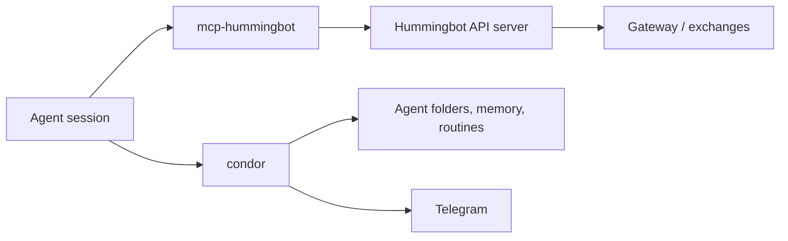

Agents act through tools served by two **MCP (Model Context Protocol)** servers. Condor starts both for every session and decides which tools each one registers, based on who is in the seat.

## The two servers

| Server | Session name | Module | What its tools do |
|---|---|---|---|
| **Hummingbot API tools** | `mcp-hummingbot` | `mcp_servers.hummingbot_api` | Trade, read markets and manage executors, bots and DEX positions through a Hummingbot API server |
| **Condor tools** | `condor` | `mcp_servers.condor` | Skills, memory, routines, Python snippets, the journal, notifications, and other agents |



If no Hummingbot API server is available to the session, Condor starts the agent with the Condor tools only.

## Which tools a seat gets

Each session runs on a **profile**. The profile depends on who is in the seat:

| Profile | Seat | Hummingbot API tools | Condor tools | Total |
|---|---|---|---|---|
| `tick` | A loop tick, running unattended | Trading tools (27) | Common tools (10) | 37 |
| `agent` | A chat with a specific agent, or a background copy of one | Trading + liquidity tools (29) | Common + orchestration tools (14) | 43 |
| `full` | The Condor chat itself, on a server you own | Trading + liquidity + admin tools (31) | Common + orchestration tools (14) | 45 |

- **Trading tools** cover everything a tick needs: portfolio, market data, executors, swaps, bots and controllers.
- **Liquidity tools** (`manage_amm`, `manage_clmm`) move liquidity directly, outside an executor. A tick doesn't get them.
- **Admin tools** (`configure_server`, `manage_gateway_config`) are operator actions. If you don't own the server the chat is pointed at, the chat drops to the `agent` profile and loses them.
- **Orchestration tools** (`manage_agents`, `manage_loops`, `control_agent`, `get_available_models`) create agents and start loops. A tick doesn't get them, because it is running inside the loop they control.

On the `tick` and `agent` profiles, `manage_controllers` refuses to upload controller code. Agents manage controller code with `manage_agent_controllers` instead. Saved configs still work.

### Narrowing an agent's tools

Two things can remove tools from the profile. Neither can add a tool the profile doesn't have.

- **The `tools:` allowlist in `AGENT.md`.** When the list has entries, every tool it doesn't name is removed. Leave it empty for the whole profile. Names can be plain (`get_prices`) or namespaced (`mcp__condor__delegate`). Condor only compares the part after the last `__`.
- **Operator mutes.** Tools you switch off for an agent, saved in `.condor/agents/<slug>/mutes.yml`.

Removed tools are never registered, so the model isn't told they exist. A name that matches no tool is silently ignored, so check the spelling of every name in an allowlist. The old name `manage_strategies` still counts as `manage_loops`.

[Architecture](/trading-agents/architecture) shows where the `tools:` list goes in `AGENT.md`.

### Tools that move money

Some calls need approval before they run: creating or stopping an executor, changing leverage, `execute_swap`, `manage_clmm` and `manage_amm` actions that move liquidity, `manage_bots` deploy, stop, start and config-update actions, and `control_agent` `start`. In a chat, Condor asks you to confirm them. In a loop, the [risk gate](/trading-agents/architecture#risk-engine) checks each one against the session's limits.

There is no `place_order` tool. The risk gate refuses that name outright, as it does an upload of raw controller code through `manage_controllers`.

## Hummingbot API tools

### Portfolio and history

| Tool | What it does | Profiles |
|---|---|---|
| `get_portfolio_overview` | Get a unified portfolio overview with balances, perpetual positions, LP positions and active orders | all |
| `search_history` | Search historical data (trades, orders, funding and more) from the backend database | all |
| `set_account_position_mode_and_leverage` | Set position mode and leverage for an account on an exchange. Either can be set on its own | all |

### Market data

| Tool | What it does | Profiles |
|---|---|---|
| `get_prices` | Get the latest price for one or more trading pairs on a connector | all |
| `get_market_data` | Read OHLCV candles as rows: `candles` (the latest bars), `historical_candles` (a time range) or `connectors` (which connectors serve candles). It is the only candle read allowed in a dry run | all |
| `explore_dex_pools` | Explore DeFi CLMM pools: discover pools, compare yields and get pool details | all |
| `explore_geckoterminal` | Explore DEX market data from GeckoTerminal (no API key needed) | all |

There is no order book or funding rate tool. For anything you need to compute on, such as indicators or cross-venue comparisons, agents use `client.market_data.*` inside `run_code`.

### Executors

| Tool | What it does | Profiles |
|---|---|---|
| `create_position_executor` | Open a directional position with stop-loss and take-profit. Spends funds | all |
| `create_grid_executor` | Run a grid of limit orders across a price range. Spends funds | all |
| `create_dca_executor` | Average into a position over a ladder of price levels. Spends funds | all |
| `create_order_executor` | Place one buy or sell order with a chosen execution strategy. Spends funds | all |
| `create_lp_executor` | Open a managed CLMM liquidity position inside a price range. Spends funds. See [LP Executor](/executors/lp-executor) | all |
| `list_executors` | List executors, filtered by account, connector, pair, type, controller or status | all |
| `get_executor` | Get one executor's full detail, optionally with its logs | all |
| `stop_executor` | Stop a running executor and close or keep its position. Also cancels an order executor | all |
| `get_performance_report` | Get aggregate executor performance | all |
| `executor_defaults` | Read, replace or reset the saved executor defaults | all |

Each `create_*_executor` tool takes an optional `controller_id`, the tag that owns the executor (default `main`). In a loop, the risk gate only allows creates that carry the session's own ID.

### Held and orphaned positions

| Tool | What it does | Profiles |
|---|---|---|
| `list_positions_held` | List spot positions held by executors | all |
| `clear_position_held` | Clear a held position that was already closed elsewhere | all |
| `list_orphaned_positions` | List terminated executors that may still own an on-chain position | all |
| `resolve_orphaned_position` | Mark an orphaned position as recovered, after closing it | all |

### DEX swaps

| Tool | What it does | Profiles |
|---|---|---|
| `quote_swap` | Price a DEX swap through Gateway. Free, signs nothing | all |
| `execute_swap` | Sign and submit a one-shot DEX swap. Spends funds | all |
| `get_swap_status` | Look up a submitted swap by its transaction hash | all |
| `search_swaps` | Query swap history with filters | all |

### Bots and controllers

| Tool | What it does | Profiles |
|---|---|---|
| `manage_bots` | Deploy, monitor and control controller-based bots, read their logs and change their runtime configs | all |
| `manage_controllers` | Manage controller templates and saved configs | all |

### Direct liquidity

| Tool | What it does | Profiles |
|---|---|---|
| `manage_amm` | Direct AMM pool operations and pool creation (Meteora, Raydium, Uniswap) | `agent`, `full` |
| `manage_clmm` | Direct CLMM position operations (Meteora, Raydium, Orca, Uniswap, PancakeSwap). Used to close an orphaned LP position | `agent`, `full` |

### Admin

| Tool | What it does | Profiles |
|---|---|---|
| `configure_server` | Show or change the Hummingbot API server connection. Takes `name`, `host`, `port`, `username` and `password` | `full` |
| `manage_gateway_config` | Read Gateway's configuration, and edit the tokens and pools it knows | `full` |

<Note>
When Condor starts the server, `configure_server` can only show the current connection. Condor passes in the server owner's credentials, so the tool refuses to change the connection. Add or switch servers in the Workspace under **Settings → Servers**.
</Note>

## Condor tools

### Skills, memory and journal

| Tool | What it does | Profiles |
|---|---|---|
| `manage_skill` | Manage skills: playbooks the agent can follow and refine | all |
| `manage_memory` | Manage the agent's persistent memory about the user | all |
| `trading_agent_journal_read` | Read the trading agent's journal | all |
| `trading_agent_journal_write` | Write a short entry to the trading agent's journal | all |

### Code, routines and controllers

| Tool | What it does | Profiles |
|---|---|---|
| `run_code` | Run a Python snippet inside Condor and get its output back | all |
| `manage_routines` | Manage and run Condor routines | all |
| `manage_agent_controllers` | Manage the controllers the agent owns: source and sample configs in its folder, pushed to the active server on demand | all |

<Warning>
`run_code` and `manage_routines` run Python in the Condor process with an unrestricted API client. A dry run refuses both.
</Warning>

### Agents and loops

| Tool | What it does | Profiles |
|---|---|---|
| `delegate` | Hand work to another agent: `start` runs it detached, `ask` blocks for its answer | all |
| `manage_agents` | Create and edit agent identities (`AGENT.md`) | `agent`, `full` |
| `manage_loops` | Create and edit loops: the playbook an agent follows each tick | `agent`, `full` |
| `control_agent` | Run and steer live agent instances: start, stop, pause, resume | `agent`, `full` |
| `get_available_models` | List every model and provider an agent can currently run on | `agent`, `full` |

### Servers and notifications

| Tool | What it does | Profiles |
|---|---|---|
| `manage_servers` | List Hummingbot API servers, and say which one this session points at | all |
| `send_notification` | Send the user a Telegram message | all |

## Configuration

When Condor starts `mcp-hummingbot`, it passes the server's URL and the owner's credentials itself. You don't need to configure anything.

When you run the server on its own, for example from another MCP host, it reads its connection in this order:

1. `~/.hummingbot_mcp/server.yml`, if the file exists. `configure_server` writes this file. When it exists, the connection variables below are ignored.
2. Otherwise, these environment variables:

| Variable | Default | Meaning |
|---|---|---|
| `HUMMINGBOT_API_URL` | `http://localhost:8000` | API server URL |
| `HUMMINGBOT_USERNAME` | `admin` | API username |
| `HUMMINGBOT_PASSWORD` | `admin` | API password |
| `HUMMINGBOT_SERVER_NAME` | `default` | Label for the server |

These variables apply either way:

| Variable | Default | Meaning |
|---|---|---|
| `HUMMINGBOT_TIMEOUT` | `30.0` | Request timeout, in seconds |
| `HUMMINGBOT_MAX_RETRIES` | `3` | Connection attempts before giving up |
| `HUMMINGBOT_RETRY_DELAY` | `2.0` | Seconds between connection attempts |
| `HUMMINGBOT_LOG_LEVEL` | `INFO` | Log level |

A standalone server runs the `full` profile unless you pass `--profile tick` or `--profile agent`.

## Running the servers by hand

Condor starts both servers for each session. To run one yourself from the Condor folder:

```bash
uv run python -m mcp_servers.hummingbot_api
uv run python -m mcp_servers.condor
```
