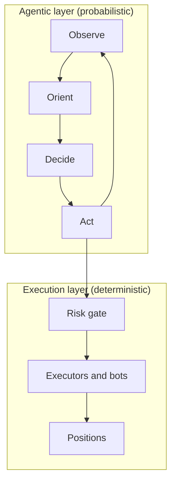

A **Trading Agent** is a folder on disk that Condor runs as a tick loop. On each tick it reads the market, asks an LLM what to do, and turns the decision into trades through Hummingbot executors or controller-based bots. A risk gate checks every call that could move money.

## Design philosophy

Trading Agents separate what LLMs do well, reasoning under uncertainty, from what traditional software does well, reliable and repeatable execution.

| Layer | Type | What it does |
|-------|------|--------------|
| **Agentic** | LLM reasoning | Reads the market and its own state, decides, and acts through tools |
| **Execution** | Deterministic Python | Enforces risk limits, runs executors and bots, tracks positions |

The result is an agent that *thinks* like a discretionary trader but *acts* like a systematic one, with a full record of every tick.

## Executor-based trading

Agents never place orders directly. The risk gate always refuses `place_order`. An agent trades in one of two ways:

- **Executors.** It creates Hummingbot executors (position, grid, DCA, order or LP) with the `create_*_executor` tools.
- **Controller-based bots.** It deploys and retunes a Hummingbot bot that runs a controller, with `manage_bots`. Every deploy must declare a loss cap (`max_global_drawdown_quote`) no larger than the session's `max_position_size_quote`. See the [Market Making Expert](/examples/market-making-expert) for a loop that works this way.

### Ownership through controller_id

Each loop session has its own ID, such as `my_agent.my_loop_3`. Every executor the session creates must carry that ID as its `controller_id`; the risk gate refuses a create without it. This gives you:

1. **Isolation.** An agent only *manages* its own executors. `list_executors` returns the whole fleet on the server, so the agent can see other executors, but the risk gate refuses any attempt to stop an executor owned by another session.
2. **A virtual portfolio.** Positions and PnL are tracked per `controller_id`, so each session has its own book even when several agents share one exchange account. See [Inventory](/trading-agents/inventory).
3. **Position handover.** When an executor closes with `keep_position=true`, the position stays in that session's inventory.

Because the ID is per session, a new session doesn't take over an earlier session's executors. See [Sessions](/trading-agents/sessions#executors-stay-with-the-session-that-opened-them).

## Mental model

> An agent is a *folder* on disk and a *tick loop* in memory. The folder is its long-term memory; the data it gathers each tick is its situational awareness; the LLM is its decision function; executors and bots are its hands; the risk gate is the wrist it can't move past.

## Run modes

Choose the mode in the Start dialog or with the loop's `execution_mode` setting.

| Mode | Ticks | Can trade? | What it records |
|------|-------|------------|-----------------|
| `dry_run` | One | No. Every action that changes anything is refused, including routines and code. | `loops/<loop>/dry_runs/experiment_N.md` |
| `run_once` | One | Yes, with the same risk checks as a loop | `loops/<loop>/dry_runs/experiment_N.md` |
| `loop` | Every `frequency_sec` until stopped, or until `max_ticks` | Yes | A new session with a journal and per-tick snapshots |

Only `loop` creates a session. Start with `dry_run` to check that the agent, server and exchange are wired up.

## Risk limits

Each session has six risk limits, set in the loop's `default_config.risk_limits` or in the Start dialog:

| Limit | Default |
|---|---|
| `max_position_size_quote` | 500 |
| `max_open_executors` | 5 |
| `max_drawdown_pct` | -1 (off) |
| `shutdown_drawdown_pct` | -1 (off) |
| `max_drift_quote` | -1 (off) |
| `max_leverage` | -1 (off) |

What each one does is on the [Architecture](/trading-agents/architecture#risk-engine) page.

## Stop vs. shutdown

- **Stop** ends the loop and leaves its executors, positions and bots open.
- **Emergency shutdown** closes the session's executors according to the agent's `shutdown.md` policy, then stops. A `shutdown_drawdown_pct` breach triggers it automatically.

See [Stopping a loop](/trading-agents/architecture#stopping-a-loop).

## Getting started

- **Run a shipped agent.** Follow one of the [agent guides](/examples/overview).
- **Create your own.** Ask Condor to build one with its [Agent Builder](/condor-agent/agent-builder), or write the folder yourself as described in [Architecture](/trading-agents/architecture#creating-your-own-agent).
- **Watch and control it.** See [Agent Loops](/getting-started/sessions).

## Learn more

| Page | What it covers |
|------|----------------|
| [Architecture](/trading-agents/architecture) | Where agents live, the folder layout, the tick pipeline and the risk engine |
| [Sessions](/trading-agents/sessions) | Session IDs, journals, snapshots, restarts and learnings |
| [Inventory](/trading-agents/inventory) | Position tracking and PnL |
| [Executors](/executors/overview) | Executor types and lifecycle |
| [MCP Tools](/trading-agents/mcp-tools) | The tools agents can call |
